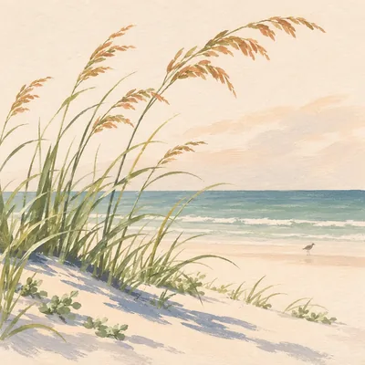
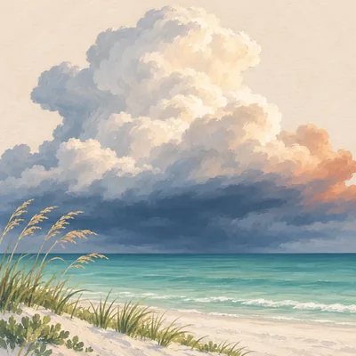
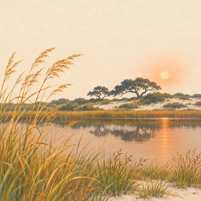
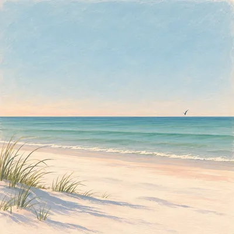
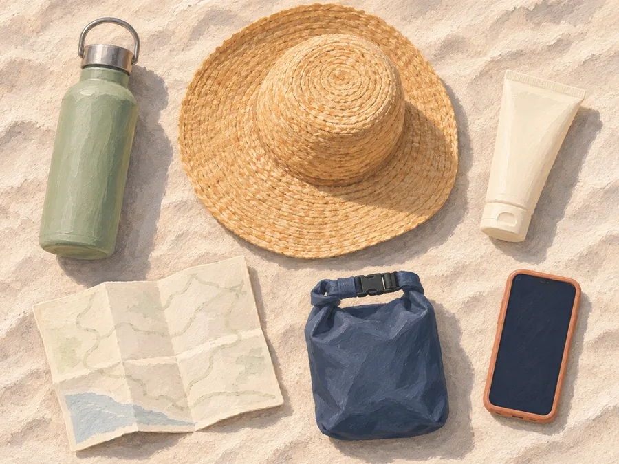


PAGE BRIEF
Primary keyword: Grayton Beach State Park
Related keywords: Grayton Beach State Park hours, entrance fee, capacity; Western Lake kayaking; Grayton Beach State Park camping, cabins; Dune Lake Trail; Grayton Beach State Park dogs; Grayton Beach vs Grayton Beach State Park
Purpose: Visitor guide (Insights). Answer first, then park vs village, arrival and capacity, visit planner, beach, paddling, Western Lake science, trails, wildlife, history, camping, seasons, rules, and FAQs.
Interactive parts (map, visit planner, trail chooser, habitat dots, checklist) are in assets/js/grayton-beach.js. Every word stays in this file, so the page reads fully without JavaScript.
Facts checked November 20, 2026. Recheck fees, capacity notices, rentals, restrooms, and lifeguard season each season.


Grayton Beach State Park covers nearly 2,000 acres on Scenic Highway 30A in Santa Rosa Beach, Florida [[1]](#ref-1). It has about a mile of powdery white-sand beach, the 100-acre Western Lake, hiking and biking trails, 30 cabins, and a 59-site campground [[1]](#ref-1) [[3]](#ref-3). The park wraps around the old beach village of Grayton Beach on three sides, with the Gulf on the fourth [[4]](#ref-4).

Two things catch first-time visitors off guard. On busy days, the park can stop letting in day visitors for several hours, even people on foot or bike [[1]](#ref-1). And dogs can't go on the park's beach, though leashed dogs can join you in other parts of the park [[3]](#ref-3).

By Ben Slaughter. Researched from Florida State Parks, Florida DEP, Florida LAKEWATCH, and Florida Shorebird Alliance documents. Facts checked November 20, 2026. Images on this page are illustrations, not photos of the park.

**A note from us:** 30A Digital Marketing is a marketing agency for Gulf Coast businesses. We like pointing people to the parks, lakes, and trails that make 30A beautiful. Guides like this one are also the kind of [local content we write for clients](/services/content/), such as [rental companies](/industries/vacation-rentals/) that help guests plan their stay.

<aside class="pw-facts" aria-labelledby="pw-facts-title">

Quick Facts

<dl>

<dt>Location</dt><dd>357 Main Park Road, Santa Rosa Beach, FL 32459, off Scenic Highway 30A in Walton County</dd>

<dt>Managed by</dt><dd>Florida State Parks (Florida Department of Environmental Protection)</dd>

<dt>Size</dt><dd>Nearly 2,000 acres</dd>

<dt>Hours</dt><dd>8 a.m. to sunset, every day</dd>

<dt>Entry fee</dt><dd>$5 per vehicle (2 to 8 people); $4 single-occupant vehicle; $2 per pedestrian, cyclist, or extra passenger</dd>

<dt>Busy days</dt><dd>Day-use entry can close when the park is full</dd>

<dt>Lifeguards</dt><dd>None; swim at your own risk</dd>

<dt>Dogs</dt><dd>On a 6-foot leash in designated areas; not on the beach or in cabins</dd>

<dt>Overnight</dt><dd>59 campsites and 30 two-bedroom cabins, by reservation</dd>

<dt>Phone</dt><dd><a href="tel:+18502678300">850-267-8300</a></dd>

</dl>
</aside>

<nav class="quick-links" aria-label="Quick links">

Quick Links

<ul>
<li><a href="#at-a-glance">Grayton Beach State Park at a Glance</a></li>
<li><a href="#village-and-park">Grayton Beach Village and the State Park</a></li>
<li><a href="#getting-there">Getting There, Parking, and Capacity Closures</a></li>
<li><a href="#plan-your-visit">Plan Your Visit by Time and Interest</a></li>
<li><a href="#beach">The Beach</a></li>
<li><a href="#paddling">Paddling Western Lake</a></li>
<li><a href="#western-lake">Western Lake and Its Opening to the Gulf</a></li>
<li><a href="#trails">Choose Your Trail</a></li>
<li><a href="#wildlife">Habitats, Wildlife, and Rare Animals</a></li>
<li><a href="#history">Park History</a></li>
<li><a href="#camping-cabins">Camping and Cabins</a></li>
<li><a href="#seasons">Seasons at Grayton Beach</a></li>
<li><a href="#rules">Accessibility, Pets, and Park Rules</a></li>
<li><a href="#checklist">Before You Go Checklist</a></li>
<li><a href="#faq">Common Questions about Grayton Beach State Park</a></li>
</ul>
</nav>

## Grayton Beach State Park at a Glance {#at-a-glance}

The park sits on both sides of Scenic 30A. South of the road are the entrance, the ranger station, the main beach, the Dune Lake Trail, and Western Lake. North of the road, the Flatwoods Trail runs through pine woods along the lake's north shore [[5]](#ref-5) [[6]](#ref-6).

The campground and cabins are inside the park, and cabin guests have their own stretch of beach [[3]](#ref-3). Point Washington State Forest lies to the north, and the park's northern trails connect to the forest's trails [[6]](#ref-6).

<figure class="pw-diagram gb-locator">
<svg viewBox="0 0 640 360" role="img" aria-labelledby="gb-loc-title gb-loc-desc">
<title id="gb-loc-title">Grayton Beach State Park and Grayton Beach village</title>
<desc id="gb-loc-desc">A simplified map. State park land surrounds the village of Grayton Beach on the west, north, and east. Scenic 30A crosses the park north of the village, with the Flatwoods Trail area north of the road. Western Lake sits east of the village. The Gulf runs along the south edge.</desc>
<rect x="0" y="300" width="640" height="60" fill="#6E9A9F"/>
<rect x="12" y="20" width="616" height="262" rx="18" fill="#EAE3D3" stroke="#CFC3AA" stroke-width="2"/>
<rect x="0" y="282" width="640" height="18" fill="#F7F2E6"/>
<line x1="12" y1="118" x2="628" y2="118" stroke="#1D3035" stroke-width="4"/>
<rect x="150" y="150" width="140" height="150" fill="#F4F0E7" stroke="#C66D54" stroke-width="2"/>
<path d="M312 196 Q340 166 392 178 Q446 190 470 214 Q480 240 452 258 Q404 276 352 262 Q318 252 306 230 Q300 212 312 196 Z" fill="#9C8670"/>
<text x="30" y="56" class="pw-svg-head">Grayton Beach State Park</text>
<text x="30" y="84" class="pw-svg-sub">North of 30A: Flatwoods Trail and pine woods</text>
<text x="490" y="110" class="pw-svg-note">Scenic 30A</text>
<text x="164" y="196" class="pw-svg-sub">Grayton Beach</text>
<text x="164" y="216" class="pw-svg-sub">village (county)</text>
<text x="352" y="226" class="pw-svg-sub" style="fill:#F4F0E7">Western Lake</text>
<text x="486" y="296" class="pw-svg-sub">Park beach</text>
<text x="30" y="336" class="pw-svg-sub" style="fill:#F4F0E7">Gulf</text>
</svg>
<figcaption>The state park surrounds Grayton Beach village on three sides, with the Gulf on the fourth. Simplified, not to scale.</figcaption>
</figure>

## Grayton Beach Village and the State Park {#village-and-park}

Grayton Beach is two places with one name. The state park is run by Florida State Parks and charges an entry fee. The village is an old beach town surrounded by the park, with a county-run public beach access at the end of Garfield Street [[4]](#ref-4).

Pick the one that fits your day. Families who want lifeguards may prefer the village access. Visitors who want a lake to paddle, trails, and picnic pavilions may prefer the park.

| | Grayton Beach State Park | Grayton Beach village access |
|---|---|---|
| Run by | Florida State Parks | Walton County |
| Entry fee | $5 per vehicle; $2 on foot or bike [[2]](#ref-2) | None for the public beach [[18]](#ref-18) |
| Lifeguards | None [[3]](#ref-3) | In season, March 1 to October 31 [[20]](#ref-20) |
| Restrooms and showers | Yes; the park map marks both [[5]](#ref-5) | Check before you go |
| Dogs on the beach | No [[3]](#ref-3) | Only with a county permit for Walton County residents and property owners [[21]](#ref-21) |
| Also there | Western Lake, trails, cabins, camping, and picnic pavilions | Village shops and restaurants |

## Getting There, Parking, and Capacity Closures {#getting-there}

The park entrance is at 357 Main Park Road, off Scenic 30A [[1]](#ref-1). From US 98, take County Road 283 south to Scenic 30A, turn left, and follow the park signs.

<button type="button" class="is-active" data-q="Grayton Beach State Park, Santa Rosa Beach, FL">Whole park</button>
<button type="button" data-q="357 Main Park Rd, Santa Rosa Beach, FL 32459">Entrance</button>
<button type="button" data-q="Grayton Beach State Park Nature Trail, Santa Rosa Beach, FL">Beach and Dune Lake Trail</button>
<button type="button" data-q="Grayton Beach State Park Flatwoods Trail, Santa Rosa Beach, FL">Flatwoods Trail</button>
<button type="button" data-q="Grayton Beach State Park Boat Ramp, Western Lake, Santa Rosa Beach, FL">Boat ramp</button>
<button type="button" data-q="Grayton Beach State Park Campground, Santa Rosa Beach, FL">Campground</button>
<button type="button" data-q="Grayton Beach State Park Cabins, Santa Rosa Beach, FL">Cabins</button>
<button type="button" data-q="Grayton Beach Regional Beach Access, Garfield St, Santa Rosa Beach, FL">Village access</button>

The map loads from Google Maps when you open it.

<button type="button" class="btn-solid" data-pw-map-open>Show map</button>
<noscript>
Turn on JavaScript to see the map, or use the directions links below.
</noscript>

<ul class="pw-trailheads">
<li>
<h3>Entrance and Ranger Station</h3>

357 Main Park Road, off Scenic 30A

<strong>Best for:</strong> every visit. Pay the entry fee, rent a kayak or NuCanoe [<a href="#ref-3">3</a>], and ask about loaner binoculars and field guides [<a href="#ref-15">15</a>].

<a class="link-caps" href="https://www.google.com/maps/dir/?api=1&amp;destination=357+Main+Park+Rd%2C+Santa+Rosa+Beach%2C+FL+32459">Get directions</a>
</li>
<li>
<h3>Beach and Dune Lake Trail</h3>

Day-use beach parking, south of 30A

<strong>Best for:</strong> beach days and short walks. Three picnic pavilions, a Mobi-Mat across the sand, and the start of the 1-mile Dune Lake Trail [<a href="#ref-3">3</a>].

<a class="link-caps" href="https://www.google.com/maps/dir/?api=1&amp;destination=Grayton+Beach+State+Park+Nature+Trail%2C+Santa+Rosa+Beach%2C+FL">Get directions</a>
</li>
<li>
<h3>Flatwoods Trailhead</h3>

North side of Scenic 30A, across from the park entrance

<strong>Best for:</strong> longer hikes and rides on the 4-mile Flatwoods Trail [<a href="#ref-5">5</a>] [<a href="#ref-6">6</a>].

<a class="link-caps" href="https://www.google.com/maps/dir/?api=1&amp;destination=Grayton+Beach+State+Park+Flatwoods+Trail%2C+Santa+Rosa+Beach%2C+FL">Get directions</a>
</li>
<li>
<h3>Western Lake Boat Ramp</h3>

Boat ramp and hand launch on Western Lake

<strong>Best for:</strong> paddlers with their own boats. Two picnic pavilions sit by the ramp [<a href="#ref-3">3</a>] [<a href="#ref-5">5</a>].

<a class="link-caps" href="https://www.google.com/maps/dir/?api=1&amp;destination=Grayton+Beach+State+Park+Boat+Ramp%2C+Western+Lake%2C+Santa+Rosa+Beach%2C+FL">Get directions</a>
</li>
<li>
<h3>Campground and Cabins</h3>

Inside the park, by reservation

<strong>Best for:</strong> overnight guests with a reservation. Cabin guests have their own stretch of beach [<a href="#ref-3">3</a>] [<a href="#ref-5">5</a>].

<a class="link-caps" href="https://www.google.com/maps/dir/?api=1&amp;destination=Grayton+Beach+State+Park+Campground%2C+Santa+Rosa+Beach%2C+FL">Campground directions</a>
<a class="link-caps" href="https://www.google.com/maps/dir/?api=1&amp;destination=Grayton+Beach+State+Park+Cabins%2C+Santa+Rosa+Beach%2C+FL">Cabin directions</a>
</li>
<li>
<h3>Grayton Beach Village Access</h3>

End of Garfield Street in the village. Not part of the state park.

<strong>Best for:</strong> Plan B when the park is full. A county beach with lifeguards in season [<a href="#ref-20">20</a>].

<a class="link-caps" href="https://www.google.com/maps/dir/?api=1&amp;destination=Grayton+Beach+Regional+Beach+Access%2C+Garfield+St%2C+Santa+Rosa+Beach%2C+FL">Get directions</a>
</li>
</ul>

### Entrance, Fees, and Hours

The park opens at 8 a.m. and closes at sunset, every day of the year [[2]](#ref-2). Entry costs $5 per vehicle with two to eight people, $4 for a car with one person, and $2 for each pedestrian, cyclist, or extra passenger [[2]](#ref-2). Overnight guests who will arrive after sunset should call the park at 850-267-8300 before 5 p.m. to get the gate code [[2]](#ref-2).

### When the Park Is Full

Since June 2024, Florida State Parks has warned that visitors may not be able to get in when the park is busy [[1]](#ref-1). The park often reaches capacity, and closures come and go. Each one can last several hours [[1]](#ref-1). Campers with reservations still get in. Day visitors, including people on foot or bike, wait until the park reopens [[1]](#ref-1).

<ol class="gb-steps">
<li><strong>Before you leave:</strong> check the park's page for notices and the day's beach flags. On summer weekends and holidays, plan to arrive soon after the 8 a.m. opening.</li>
<li><strong>At the gate:</strong> have your fee ready and know which lot you want: beach, trailhead, or boat ramp.</li>
<li><strong>If the park is full:</strong> don't wait in the road. Head to a Plan B below and check back later in the day.</li>
</ol>

**Plan B when the park is full.** Other parks fill on busy days too, so check their notices as well.

- **Grayton Beach village access:** the county's public beach in the village, with lifeguards in season [[20]](#ref-20).
- **Deer Lake State Park:** a state park farther east on 30A, with its own beach and coastal dune lake.
- **Topsail Hill Preserve State Park:** a state park at the west end of 30A, with coastal dune lakes, tall dunes, and miles of trails.
- **Point Washington State Forest:** forest trails north of 30A, with no beach. Our [Point Washington Wildlife Management Area guide](/insights/point-washington-wildlife-management-area/) covers its trailheads and loops.

For the Curious: How Busy Is Busy?

In fiscal year 2023–24, the park averaged 2,953 visitors a day, up from 2,621 the year before [<a href="#ref-8">8</a>]. The same state report lists the park's planned "optimal" carrying capacity as 2,316 people a day [<a href="#ref-8">8</a>]. These are yearly averages, so busy summer days run higher and quiet winter days run lower.

<figure class="chart chart-scaled" aria-labelledby="chart-visitors-title">
<figcaption class="chart-title" id="chart-visitors-title">Average Daily Visitors and Planned Capacity</figcaption>

FY 2022–23 average2,621

FY 2023–24 average2,953

Planned optimal capacity2,316

Florida DEP, 2024 biennial land management report [<a href="#ref-8">8</a>]. Yearly averages, not peak days.

</figure>

## Plan Your Visit by Time and Interest {#plan-your-visit}

Pick the plan that matches your time, then adjust it for weather, crowds, and your group. Times are our estimates, not park rules.

Plan Your Visit

<fieldset>
<legend>How much time do you have?</legend>
<label><input type="radio" name="gb-time" value="two"> About 2 hours</label>
<label><input type="radio" name="gb-time" value="half"> Half a day</label>
<label><input type="radio" name="gb-time" value="full"> A full day</label>
</fieldset>
<fieldset>
<legend>What do you most want to do?</legend>
<label><input type="radio" name="gb-want" value="beach"> Beach time</label>
<label><input type="radio" name="gb-want" value="paddle"> Paddling</label>
<label><input type="radio" name="gb-want" value="trails"> Hiking or biking</label>
<label><input type="radio" name="gb-want" value="wildlife"> Birds and photos</label>
</fieldset>
<fieldset>
<legend>Who's coming?</legend>
<label><input type="radio" name="gb-who" value="kids"> Kids</label>
<label><input type="radio" name="gb-who" value="dog"> A dog</label>
<label><input type="radio" name="gb-who" value="mobility"> Someone with limited mobility</label>
<label><input type="radio" name="gb-who" value="adults"> Just adults</label>
</fieldset>

Pick an answer in each row, and the plan that fits moves to the top.

<ul class="pw-trails gb-plans" data-gb-plans>
<li data-plan="two" data-tags="beach trails wildlife">
<h3>Two Hours</h3>
<ol>
<li>Park at the beach lot, walk the boardwalk to the Gulf, and spend about an hour on the sand.</li>
<li>Walk the 1-mile Dune Lake Trail through the dunes and along the salt marsh, about 45 minutes [<a href="#ref-3">3</a>] [<a href="#ref-5">5</a>].</li>
<li>If the outfall is open, look for the channel where Western Lake runs into the Gulf.</li>
</ol>

</li>
<li data-plan="half" data-tags="beach paddle trails">
<h3>Half Day</h3>
<ol>
<li>Arrive near opening and claim a beach spot or a picnic pavilion. Pavilions are first come, first served [<a href="#ref-3">3</a>].</li>
<li>Rent a kayak or NuCanoe at the ranger station and paddle Western Lake for an hour or two [<a href="#ref-3">3</a>]. Call ahead for rates.</li>
<li>Eat lunch at a pavilion, then walk the Dune Lake Trail in the afternoon.</li>
</ol>

</li>
<li data-plan="full" data-tags="beach paddle trails wildlife">
<h3>Full Day</h3>
<ol>
<li>Start early on the Flatwoods Trail north of 30A: 4 miles through pine woods and along the lake's north shore [<a href="#ref-5">5</a>] [<a href="#ref-6">6</a>]. Ride it instead if you brought a bike.</li>
<li>Late morning: paddle Western Lake.</li>
<li>Afternoon: beach and swimming. Check the flags first.</li>
<li>Enjoy the late light on the beach, and head for your car before sunset, when the park closes [<a href="#ref-2">2</a>].</li>
</ol>

</li>
</ul>

### Notes for Your Group

<ul class="gb-notes" data-gb-notes>
<li data-who="kids"><strong>With kids:</strong> the Dune Lake Trail is short, with plenty to spot along the way. The park has no lifeguards, so stay within arm's reach in the water [<a href="#ref-3">3</a>].</li>
<li data-who="dog"><strong>With a dog:</strong> dogs can't go on the park's beach [<a href="#ref-3">3</a>]. Plan a leashed walk on the trails instead [<a href="#ref-17">17</a>], and read the <a href="#rules">pet rules</a> below.</li>
<li data-who="mobility"><strong>With limited mobility:</strong> Mobi-Mats cross the sand at the day-use beach and the cabin beach. Call ahead to reserve the beach wheelchair, and use the accessible picnic table at the large beach pavilion [<a href="#ref-3">3</a>].</li>
<li data-want="wildlife"><strong>For birds and photos:</strong> come at opening or in the last hour before sunset, when the light is low and the beach is quiet. Bring binoculars, or ask at the ranger station about loaner binoculars and field guides [<a href="#ref-15">15</a>].</li>
</ul>

## The Beach {#beach}

The park has about a mile of white-sand beach for swimming, sunbathing, and surf fishing [[3]](#ref-3). Boardwalks cross the dunes from the parking areas, and three picnic pavilions sit in the beach day-use area [[3]](#ref-3). The park has no lifeguards, so you swim at your own risk [[3]](#ref-3).

### Beach Flags and Swimming Safety

Walton County flies Florida's beach warning flags, and the colors tell you how rough the water is [[16]](#ref-16). Check the flag before you go in. For flag updates by text, send SAFETY to 31279 [[18]](#ref-18).

<ul class="gb-flags">
<li><strong>Green:</strong> low hazard. Calm water, but still use caution [<a href="#ref-16">16</a>].</li>
<li><strong>Yellow:</strong> medium hazard. Moderate surf or currents [<a href="#ref-16">16</a>].</li>
<li><strong>Red:</strong> high hazard. High surf or strong currents [<a href="#ref-16">16</a>].</li>
<li><strong>Double red:</strong> water closed to the public. Going in can bring a $500 fine and criminal charges [<a href="#ref-16">16</a>].</li>
<li><strong>Purple:</strong> stinging marine life, such as jellyfish or stingrays [<a href="#ref-16">16</a>]. It can fly beside another color, so read both together.</li>
</ul>

### Dune Rules

Stay on the boardwalks and marked paths. Walking on dunes breaks them down so they wash away faster [[19]](#ref-19). Sea oats hold the sand in place with their roots, and the dunes shelter the endangered Choctawhatchee beach mouse [[19]](#ref-19). Snowy plovers nest right on the sand, so stay out of posted nesting areas [[19]](#ref-19).

## Paddling Western Lake {#paddling}

Western Lake is a 100-acre coastal dune lake inside the park, and it's the park's paddling water [[3]](#ref-3). Bring your own canoe, kayak, or paddleboard, or rent a NuCanoe or kayak at the ranger station [[3]](#ref-3). Rentals come through the Friends of Grayton Beach and Deer Lake State Parks and include paddles and life vests [[3]](#ref-3). Call the park for current rates.

A boat ramp and a hand launch give you access to the lake [[3]](#ref-3) [[5]](#ref-5). Jet-propelled watercraft, such as jet skis, are not allowed [[3]](#ref-3).

Tips for a good paddle:

- Go early in the day. Summer afternoons often bring thunderstorms.
- Wear your life vest, and carry water and sun protection.
- Fish only with the proper Florida fishing license [[3]](#ref-3).
- Get off the water when you hear thunder.

The park also holds two smaller coastal dune lakes, Alligator Lake and Little Redfish Lake [[7]](#ref-7). The boat ramp and hand launch are on Western Lake [[5]](#ref-5).

## Western Lake and Its Opening to the Gulf {#western-lake}

Western Lake is a coastal dune lake, a shallow lake just behind the beach dunes. Walton County has 15 named coastal dune lakes along its coast [[14]](#ref-14). Most of the time, a ridge of sand separates each lake from the Gulf.

After heavy rain, the lake rises until water cuts a channel through the beach to the Gulf. This channel is called an outfall [[14]](#ref-14). Lake water drains out, and tides and waves can push salt water in. Later, waves pile sand back and close the channel. That cycle makes the lake brackish, a mix of fresh and salt water [[14]](#ref-14).

<figure class="pw-diagram pw-outfall">

<svg viewBox="0 0 350 245" role="img" aria-labelledby="gb-outfall-a-title"><title id="gb-outfall-a-title">Outfall closed: the lake sits behind a sand berm, separate from the Gulf.</title>
<text x="20" y="40" class="pw-svg-head">Outfall closed</text>
<path d="M20 120 Q60 114 100 120 Q125 123 150 122 L150 200 H20 Z" fill="#9C8670"/>
<path d="M240 152 Q285 144 330 152 L330 200 H240 Z" fill="#6E9A9F"/>
<path d="M136 124 Q170 82 204 112 Q226 132 246 152 L246 200 H136 Z" fill="#EAE3D3" stroke="#CFC3AA" stroke-width="1.5"/>
<text x="56" y="228" class="pw-svg-sub">Lake</text>
<text x="160" y="228" class="pw-svg-sub">Sand berm</text>
<text x="272" y="228" class="pw-svg-sub">Gulf</text>
</svg>
<svg viewBox="0 0 350 245" role="img" aria-labelledby="gb-outfall-b-title"><title id="gb-outfall-b-title">Outfall open: a channel cuts through the berm and lake water flows into the Gulf.</title><defs><marker id="gb-arrow" viewBox="0 0 10 10" refX="8" refY="5" markerWidth="7" markerHeight="7" orient="auto"><path d="M0 0 L10 5 L0 10 Z" fill="#C66D54"/></marker></defs>
<text x="20" y="40" class="pw-svg-head">Outfall open</text>
<path d="M20 126 Q60 120 100 126 Q125 129 150 128 L150 200 H20 Z" fill="#9C8670"/>
<path d="M240 152 Q285 144 330 152 L330 200 H240 Z" fill="#6E9A9F"/>
<path d="M146 128 L246 152 L246 200 H146 Z" fill="#9C8670"/>
<path d="M136 130 Q156 96 176 116 L176 200 H136 Z" fill="#EAE3D3" stroke="#CFC3AA" stroke-width="1.5"/>
<path d="M206 124 Q226 120 246 152 L246 200 H206 Z" fill="#EAE3D3" stroke="#CFC3AA" stroke-width="1.5"/>
<path d="M110 104 Q190 104 262 136" fill="none" stroke="#C66D54" stroke-width="2.5" marker-end="url(#gb-arrow)"/>
<text x="56" y="228" class="pw-svg-sub">Lake</text>
<text x="166" y="228" class="pw-svg-sub">Channel</text>
<text x="272" y="228" class="pw-svg-sub">Gulf</text>
</svg>

<figcaption>Closed: the lake sits behind the beach. Open: after high water, a channel cuts through and lake water runs to the Gulf. Not to scale.</figcaption>
</figure>

Salt water doesn't mix evenly. Seawater is heavier than fresh water, so it sinks to the bottom. In samples taken from 2002 to 2008, bottom water at both stations was more than one and a half times as salty as the surface [[9]](#ref-9).

<figure class="chart chart-scaled" aria-labelledby="chart-salinity-title">
<figcaption class="chart-title" id="chart-salinity-title">Western Lake Salinity, Surface and Bottom</figcaption>

Western station, surface6.5 ppt

Western station, bottom11.5 ppt

Grayton arm, surface12.0 ppt

Grayton arm, bottom19.0 ppt

Typical seawaterabout 35 ppt

Average salinity in parts per thousand (ppt), from Florida LAKEWATCH sampling, 2002 to 2008 [<a href="#ref-9">9</a>]. The Grayton arm is the lake's western lobe, near the village. Typical open-ocean seawater is about 35 ppt. These are historical averages, not current conditions.

</figure>

For the Curious: Western Lake by the Numbers

<ul>
<li><strong>Two basins:</strong> a 2001 LAKEWATCH survey mapped the Western basin at 93 acres, with depths to about 11 feet, and the Grayton basin at 53 acres [<a href="#ref-10">10</a>] [<a href="#ref-11">11</a>]. The surveys used different boundaries, so the two numbers don't add up to the lake's total.</li>
<li><strong>Nutrients differ by arm:</strong> ten-year averages show total phosphorus of 7.21 micrograms per liter in the park arm and 17.56 in the Grayton arm, closer to the village [<a href="#ref-7">7</a>]. More phosphorus can mean more algae.</li>
<li><strong>The three lakes differ too:</strong> chlorophyll, a measure of algae, averaged 9.30 micrograms per liter in Little Redfish Lake and 1.75 in Western Lake's park arm [<a href="#ref-7">7</a>].</li>
<li><strong>Shoreline plants:</strong> in a 2001 survey, duck-potato and black rush each showed up in 9 of 10 sample spots along the Western station shoreline [<a href="#ref-12">12</a>].</li>
</ul>

These are historical samples from 2001 to 2008. They are not current conditions and not swimming advice. For water quality today, check the Florida Department of Health's beach advisories.

## Choose Your Trail {#trails}

Grayton Beach State Park has a 1-mile nature trail through the dunes south of 30A and a 4-mile trail for hikers and cyclists through the pine woods north of 30A [[3]](#ref-3) [[5]](#ref-5). Two short trails let you shorten or extend the northern route. Distances come from the park's October 2025 map [[5]](#ref-5). Older pages list the long trail at 3.8 to 4.5 miles.

Find Your Trail

<fieldset>
<legend>How much time do you have?</legend>
<label><input type="radio" name="pw-time" value="short"> Under 1 hour</label>
<label><input type="radio" name="pw-time" value="mid"> 1 to 3 hours</label>
<label><input type="radio" name="pw-time" value="long"> Half a day or more</label>
</fieldset>
<fieldset>
<legend>How are you getting around?</legend>
<label><input type="radio" name="pw-mode" value="walk"> Walking</label>
<label><input type="radio" name="pw-mode" value="bike"> Biking</label>
</fieldset>

Pick an answer in each row, and the trails that fit move to the top.

Times are our estimate: about 2 miles an hour walking on sand, 6 biking on unpaved trail, and 10 biking on pavement. Your pace may differ.

<ul class="pw-trails" data-pw-trails>
<li data-trail="dune">
<h3>Dune Lake Trail</h3>

1.0 mile · Starts at the beach parking area · Hiking

The Dune Lake Trail starts at the beach parking area [<a href="#ref-3">3</a>]. It crosses the dunes, follows the salt marsh along Western Lake, and circles back through pine flatwoods [<a href="#ref-3">3</a>]. Look for low, twisted sand live oaks shaped by the salt wind. The sand is soft and the shade is thin, so bring water.

</li>
<li data-trail="lakeloop">
<h3>Western Lake Loop</h3>

0.70 mile · North of 30A · Hiking

This short loop north of 30A gives you lake views without the full Flatwoods hike [<a href="#ref-5">5</a>]. Check the park map to see where it meets the other northern trails.

</li>
<li data-trail="flatwoods">
<h3>Flatwoods Trail</h3>

4.0 miles · Across 30A from the park entrance · Hiking and biking

The Flatwoods Trail starts across Scenic 30A from the park entrance [<a href="#ref-6">6</a>]. It runs through pine flatwoods and along the north shore of Western Lake [<a href="#ref-5">5</a>] [<a href="#ref-15">15</a>]. Watch the lake edges for great blue herons and bald eagles [<a href="#ref-15">15</a>]. Low spots can be muddy after rain. The park recommends helmets for all cyclists, and Florida law requires them for young riders [<a href="#ref-3">3</a>].

</li>
<li data-trail="shortcut">
<h3>Shortcut Trail</h3>

0.35 mile · North of 30A · Connector

This connector cuts across the northern trails so you can shorten the Flatwoods route [<a href="#ref-5">5</a>]. Use the park map to see where it joins.

</li>
<li data-trail="timpoochee">
<h3>Timpoochee Trail</h3>

18.6 miles (regional) · Runs along Scenic 30A · Paved, walking and biking

The Timpoochee Trail is a paved path along Scenic 30A through South Walton [<a href="#ref-5">5</a>]. Only a short piece passes the park, but it's an easy way to bike to the entrance. Cyclists pay the $2 entry fee and, like everyone else, wait outside when the park is full [<a href="#ref-1">1</a>] [<a href="#ref-2">2</a>]. The park's northern trails also connect to the trails of Point Washington State Forest and to the paved 30A path [<a href="#ref-6">6</a>].

</li>
</ul>

Download the [official park map (PDF)](https://www.floridastateparks.org/sites/default/files/media/file/FINAL-GraytonBeach-HandheldMap-%2810-8-25%29.pdf) before you go. Check with the ranger station for closures after storms or prescribed burns.

## Habitats, Wildlife, and Rare Animals {#wildlife}

Walk from the Gulf to the pine woods and you'll cross several habitats in under a mile. The park brochure lists 13 natural communities, including beach dune, scrub, flatwoods, tidal marsh, and the coastal dune lake itself [[6]](#ref-6). The 2013 management plan describes 14 [[7]](#ref-7).

### Habitats You'll Walk Through

<figure class="pw-habitat" data-pw-habitat>

<button type="button" class="pw-dot" style="left:8%" data-zone="beach" aria-label="Beach">1</button>
<button type="button" class="pw-dot" style="left:23%" data-zone="foredune" aria-label="Foredune">2</button>
<button type="button" class="pw-dot" style="left:38%" data-zone="scrub" aria-label="Scrub">3</button>
<button type="button" class="pw-dot" style="left:51%" data-zone="marsh" aria-label="Salt marsh">4</button>
<button type="button" class="pw-dot" style="left:63%" data-zone="lake" aria-label="Western Lake">5</button>
<button type="button" class="pw-dot" style="left:79%" data-zone="flatwoods" aria-label="Pine flatwoods">6</button>
<button type="button" class="pw-dot" style="left:93%" data-zone="prairie" aria-label="Wet prairie">7</button>

<figcaption>Tap a number to read about that habitat. Illustration, not to scale.</figcaption>
</figure>

<ul class="pw-zones">
<li id="zone-beach" data-zone="beach">1<strong>Beach:</strong> open sand where snowy plovers nest and shorebirds feed [<a href="#ref-15">15</a>] [<a href="#ref-19">19</a>].</li>
<li id="zone-foredune" data-zone="foredune">2<strong>Foredune:</strong> tall dunes held in place by sea oats. Stay on the boardwalks here.</li>
<li id="zone-scrub" data-zone="scrub">3<strong>Scrub:</strong> low, wind-shaped sand live oaks and Florida rosemary on dry sand behind the dunes. The Dune Lake Trail passes through it.</li>
<li id="zone-marsh" data-zone="marsh">4<strong>Salt marsh:</strong> grasses and rushes where lake water meets the land.</li>
<li id="zone-lake" data-zone="lake">5<strong>Western Lake:</strong> brackish water that changes with each outfall opening (see <a href="#western-lake">Western Lake and Its Opening to the Gulf</a>).</li>
<li id="zone-flatwoods" data-zone="flatwoods">6<strong>Pine flatwoods:</strong> open pine woods with saw palmetto. The Flatwoods Trail crosses this zone [<a href="#ref-5">5</a>].</li>
<li id="zone-prairie" data-zone="prairie">7<strong>Wet prairie:</strong> open, grassy wetland kept open by prescribed fire [<a href="#ref-7">7</a>].</li>
</ul>

### Choctawhatchee Beach Mouse

The Choctawhatchee beach mouse is an endangered mouse that digs its burrows in the park's dunes [[19]](#ref-19). The park helped bring it back. Biologists returned beach mice to the park in 1987 and 1989, then added more in 2011 [[7]](#ref-7). The mice eat the seeds of dune plants and spread them across the dunes [[19]](#ref-19). You're unlikely to see one, because they come out at night. Staying off the dunes protects their burrows.

### A Snowy Plover Hatched Here Lived 17 Years

A small shorebird that hatched at Grayton Beach State Park became the oldest known snowy plover in Florida. Banding records show it lived 17 years and nested at Tyndall Air Force Base from 1998 to 2015, according to a 2019 Florida Shorebird Alliance report [[13]](#ref-13). Snowy plover chicks can walk more than nine miles looking for food when they're only days old [[13]](#ref-13). That's why protected beach areas reach past the nests themselves.

### Birds, Bears, and Other Animals

The park is a site on the Great Florida Birding and Wildlife Trail, and its beach has nesting snowy plovers [[15]](#ref-15). Bald eagles and ospreys are found throughout the park [[3]](#ref-3). In winter, scan offshore for northern gannets and Bonaparte's gulls [[15]](#ref-15). Florida black bears, white-tailed deer, and gray foxes also live here [[3]](#ref-3). Store food and trash where bears can't reach them, especially at camp.

### Fire and Wet Prairie

The park uses prescribed fire, set by trained crews, to keep pine flatwoods and wet prairie healthy. Without fire, shrubs grow over the grasses and wildflowers that wet prairie animals need [[7]](#ref-7). Blackened trunks along the Flatwoods Trail are a sign of this care, not damage.

For the Curious: Fire and Restoration by the Numbers

The 2013 plan listed 332 acres of wet prairie and set a goal of burning 280 to 685 acres a year across fire-dependent habitat [<a href="#ref-7">7</a>]. A 2024 state report lists 28 records of imperiled species in the park and 80 acres of completed water-flow restoration [<a href="#ref-8">8</a>]. These are planning and tracking figures, not a count of what you'll see.

### Animals and Plants to Look For

<ul class="pw-species">
<li>
Snowy plover

Small, pale shorebird the color of dry sand, with a dark mark behind the eye.

Nests on the beach · Open sand
</li>
<li>
Choctawhatchee beach mouse

Pale, sandy-colored mouse that digs burrows in the dunes and comes out at night.

Year-round · Dunes
</li>
<li>
Bald eagle

White head and tail on a dark brown body.

Most often fall through spring · Around the lake
</li>
<li>
Osprey

Brown above and white below. Dives feet first for fish.

Year-round · Lake and Gulf
</li>
<li>
Sea oats

Tall dune grass with golden seed heads. Its roots hold the sand in place.

Seed heads late summer and fall · Foredunes
</li>
<li>
Duck-potato

Arrow-shaped leaves and white, three-petal flowers at the water's edge.

Flowers in summer · Lake shoreline
</li>
<li>
Black rush

Dark, stiff, sharp-tipped rush that grows in dense stands.

Year-round · Marsh edges
</li>
</ul>

## Park History {#history}

Grayton Beach State Park began in 1964 with about 356 acres and opened to the public in 1968 [[4]](#ref-4). The state added land in 1985, 1993, and 1995 [[4]](#ref-4). The park takes its name from Grayton Beach, one of the oldest towns on Walton County's coast [[4]](#ref-4).

<ol class="pw-timeline">
<li>Sept. 21, 1964 The state acquires about 356 acres, the first piece of the park [<a href="#ref-4">4</a>].</li>
<li>1968 The park is dedicated and opens [<a href="#ref-4">4</a>].</li>
<li>1985, 1993, and 1995 More land joins the park [<a href="#ref-4">4</a>].</li>
<li>1987 and 1989 Biologists return Choctawhatchee beach mice to the dunes [<a href="#ref-7">7</a>].</li>
<li>1998 to 2015 A snowy plover that hatched at the park nests at Tyndall Air Force Base and lives to 17 [<a href="#ref-13">13</a>].</li>
<li>2011 More beach mice join the park's population [<a href="#ref-7">7</a>].</li>
<li>2013 The state approves the park's management plan [<a href="#ref-7">7</a>].</li>
<li>June 2024 The park starts posting capacity closures for busy days [<a href="#ref-1">1</a>].</li>
</ol>

The park also protects history you can't see from the trail. A 2024 state report lists 19 recorded cultural or historical sites in the park [[8]](#ref-8). Their locations aren't public. If you find an artifact, leave it in place and tell a ranger.

For the Curious: The Park and the Local Economy

In fiscal year 2010–11, the state estimated that park visitors spent $4.9 million in the local economy, supporting about 114 jobs [<a href="#ref-7">7</a>]. That's an older model estimate, not a current figure.

## Camping and Cabins {#camping-cabins}

Grayton Beach State Park has 59 campsites and 30 cabins [[3]](#ref-3). Reservations open up to 11 months ahead, so book early for busy weeks [[3]](#ref-3).

### The Campground

Each campsite has water and electricity, and some have sewer hookups [[3]](#ref-3). Four sites are accessible, RVs can be up to 40 feet long, and pets are welcome in the campground [[3]](#ref-3).

### The Cabins

The park has 30 two-bedroom, one-bath duplex cabins, and two of them are accessible [[3]](#ref-3). Each sleeps up to six people and has a kitchen, a screened porch, an outdoor grill, central heat and air, and a gas fireplace that runs from November through March [[3]](#ref-3). The cabins have no TVs or phones. They require a two-night minimum stay, allow two vehicles, and don't allow pets [[3]](#ref-3). Cabin guests have their own beach access with a Mobi-Mat [[3]](#ref-3).

### Campsite or Cabin?

| | Campsite | Cabin |
|---|---|---|
| Sleeps | Your tent or RV (RVs up to 40 feet) | Up to 6 people |
| Comes with | Water and electric; some sewer hookups | Kitchen, screened porch, grill, and fireplace |
| Pets | Welcome in the campground | Not allowed |
| Accessible options | 4 accessible sites | 2 accessible cabins |
| Minimum stay | Set by your reservation | Two nights |
| Booking window | Up to 11 months ahead | Up to 11 months ahead |

Source: [[3]](#ref-3). Check current nightly rates on the park's [hours and fees page](https://www.floridastateparks.org/parks-and-trails/grayton-beach-state-park/hours-fees) [[2]](#ref-2).

## Seasons at Grayton Beach {#seasons}

The park is open every day, but each season brings different crowds and conditions.

<ul class="pw-seasons">
<li>

Spring

Mild days for hiking and birding. Shorebird nesting season begins, so watch for posted nesting areas on the beach [<a href="#ref-19">19</a>].

</li>
<li>

Summer

Warm water and the biggest crowds. Expect possible capacity closures [<a href="#ref-1">1</a>], afternoon thunderstorms, and purple flags when jellyfish are around.

</li>
<li>

Fall

Cooler trails and smaller crowds once summer ends. Hurricane season runs through November 30, so watch the forecast.

</li>
<li>

Winter

Quiet beach walks and cool paddling days. Look offshore for northern gannets [<a href="#ref-15">15</a>].

</li>
</ul>

## Accessibility, Pets, and Park Rules {#rules}

The park has accessible cabins, accessible campsites, Mobi-Mats at both the day-use beach and the cabin beach, and a beach wheelchair [[3]](#ref-3). Call ahead to reserve the beach wheelchair [[3]](#ref-3). The large beach pavilion has an accessible picnic table [[3]](#ref-3).

We didn't find any trail in the park listed as wheelchair accessible. The trails are sandy and can be soft or muddy. Call the park at 850-267-8300 about current conditions before you go.

**Pets:** pets can visit designated day-use areas on a handheld leash 6 feet or shorter, and owners must pick up after them [[3]](#ref-3). Pets can't go on beaches, playgrounds, bathing areas, cabins, cabin areas, or park buildings [[3]](#ref-3). Walton County's public beaches are closed to dogs too, unless the owner is a county resident or property owner with a county dog permit [[21]](#ref-21).

**Other rules:**

- All plants, animals, and park property are protected. Leave sea oats, plants, and wildlife as you find them [[6]](#ref-6).
- Fish only with the proper Florida fishing license [[3]](#ref-3).
- Jet-propelled watercraft are not allowed on Western Lake [[3]](#ref-3).
- The park closes at sunset [[2]](#ref-2).
- Bring a refillable bottle. The park has a water bottle refill station at the trailhead [[3]](#ref-3).

## Before You Go Checklist {#checklist}

Run through this list the night before. Your checks save in this browser, and you can print the list.

<figure class="article-figure">

<figcaption>Water, sun protection, a map, and a dry bag for your phone cover most visits.</figcaption>
</figure>

Before You Go

<ul>
<li><label><input type="checkbox"> Check the park's page for capacity or closure notices.</label></li>
<li><label><input type="checkbox"> Check the beach flags. Text SAFETY to 31279 for updates.</label></li>
<li><label><input type="checkbox"> On summer weekends and holidays, plan to arrive near 8 a.m.</label></li>
<li><label><input type="checkbox"> Have the entry fee ready: $5 per vehicle, or $2 on foot or bike.</label></li>
<li><label><input type="checkbox"> Call 850-267-8300 for kayak rental rates or to reserve the beach wheelchair.</label></li>
<li><label><input type="checkbox"> Download the official park map.</label></li>
<li><label><input type="checkbox"> Pack water, sun protection, and bug spray.</label></li>
<li><label><input type="checkbox"> Bringing a dog? Pack a 6-foot leash and waste bags, and plan your day around the beach rule.</label></li>
<li><label><input type="checkbox"> Get a Florida fishing license if you plan to fish.</label></li>
<li><label><input type="checkbox"> Save a Plan B in case the park is full.</label></li>
</ul>

<button type="button" class="btn-outline" data-pw-print>Print checklist</button>
<button type="button" class="btn-outline" data-pw-clear>Clear checks</button>

Fees and hours: [[2]](#ref-2). Park map: [[5]](#ref-5). Flag updates: [[18]](#ref-18).

## Common Questions about Grayton Beach State Park {#faq}

**Is Grayton Beach State Park worth visiting?** Yes, if you want more than a beach. Grayton Beach State Park adds a coastal dune lake you can paddle, a 4-mile trail through the pine woods, and protected dunes. Arrive early on busy days, because the park can close to day visitors when it fills.

**How much does Grayton Beach State Park cost?** Entry is $5 per vehicle with two to eight people, or $4 for a single driver. Pedestrians, cyclists, and extra passengers pay $2 each. Camping, cabins, and boat rentals cost extra.

**What time does the park open and close?** The park opens at 8 a.m. and closes at sunset, every day of the year. Overnight guests arriving after sunset should call 850-267-8300 before 5 p.m. for the gate code.

**What happens when the park is full?** The park stops letting in day visitors, including people on foot or bike, until space opens up. Closures can last several hours. Campers with reservations still get in. Arrive early, or head to another beach and try again later.

**Can you swim at Grayton Beach State Park, and are there lifeguards?** Yes, you can swim in the Gulf, but the park has no lifeguards. Check the beach flags before you go in. When double red flags fly, the water is closed to the public.

**Are dogs allowed at Grayton Beach State Park?** Yes, on a leash 6 feet or shorter in designated areas, including the campground. Dogs can't go on the beach or into the cabins or cabin area. Travel guides say leashed dogs may also use the trails.

**Can you rent kayaks on Western Lake?** Yes. The ranger station rents kayaks and NuCanoes through the park's Friends group, with paddles and life vests included. Call 850-267-8300 for rates. You can also launch your own boat.

**What is the easiest trail?** The Dune Lake Trail. It's a 1-mile loop from the beach parking area through the dunes, along the salt marsh, and back through pine flatwoods. The sand is soft in spots, so wear good shoes.

**Does the park have restrooms and showers?** Yes. The park map marks restrooms and showers, and a water bottle refill station sits at the trailhead. Restrooms sometimes close for maintenance, so check the park's notices before you go.

**Can you visit without camping?** Yes. Day visitors pay the entry fee at the gate and can use the beach, trails, lake, and picnic pavilions until sunset.

**Is the beach wheelchair accessible?** Mobi-Mats cross the sand at the day-use beach and the cabin beach, and the park has a beach wheelchair you can reserve by phone. We didn't find any trail listed as accessible.

**What is the difference between Grayton Beach and Grayton Beach State Park?** Grayton Beach is a small village with a county-run public beach access. Grayton Beach State Park is the state park that surrounds the village on three sides, with Western Lake, trails, cabins, and camping.

## References {#references}

Sources checked November 20, 2026.

<ol>
<li id="ref-1">Florida State Parks, <a href="https://www.floridastateparks.org/graytonbeach"><em>Grayton Beach State Park</em></a></li>
<li id="ref-2">Florida State Parks, <a href="https://www.floridastateparks.org/parks-and-trails/grayton-beach-state-park/hours-fees"><em>Grayton Beach State Park: Hours and Fees</em></a></li>
<li id="ref-3">Florida State Parks, <a href="https://www.floridastateparks.org/parks-and-trails/grayton-beach-state-park/experiences-amenities"><em>Grayton Beach State Park: Experiences and Amenities</em></a></li>
<li id="ref-4">Florida State Parks, <a href="https://www.floridastateparks.org/parks-and-trails/grayton-beach-state-park/history"><em>Grayton Beach State Park: History</em></a></li>
<li id="ref-5">Florida State Parks, <a href="https://www.floridastateparks.org/sites/default/files/media/file/FINAL-GraytonBeach-HandheldMap-%2810-8-25%29.pdf"><em>Grayton Beach State Park</em> handheld map, October 2025</a> (PDF)</li>
<li id="ref-6">Florida State Parks, <a href="https://www.floridastateparks.org/sites/default/files/media/file/Grayton%20Beach%20-%201114_0.pdf"><em>Grayton Beach State Park</em> brochure, 2014</a> (PDF)</li>
<li id="ref-7">Florida Department of Environmental Protection, <a href="https://floridadep.gov/sites/default/files/06.14.2013_GBSP_Approved_Plan.pdf"><em>Grayton Beach State Park Approved Unit Management Plan</em>, 2013</a> (PDF)</li>
<li id="ref-8">Florida Department of Environmental Protection, <a href="https://floridadep.gov/sites/default/files/Land%20Management%20Uniform%20Accounting%20Council%20%28LMUAC%29%20Biennial%20Report%20%28FY%202022-24%29.pdf"><em>Land Management Uniform Accounting Council Biennial Report, FY 2022–24</em></a> (PDF)</li>
<li id="ref-9">Florida LAKEWATCH, <a href="https://lakewatch.ifas.ufl.edu/media/lakewatchifasufledu/extension/del204017lake-management-plans/dune-lake/Dune-Lake-Management-Plan.pdf"><em>Walton County Dune Lakes management report</em>, 2008</a> (PDF)</li>
<li id="ref-10">Florida LAKEWATCH, <a href="https://lakewatch.ifas.ufl.edu/media/lakewatchifasufledu/bathymetric-maps/Western-Walton-2021.pdf"><em>Western (Walton) bathymetric map</em></a> (PDF)</li>
<li id="ref-11">Florida LAKEWATCH, <a href="https://lakewatch.ifas.ufl.edu/media/lakewatchifasufledu/bathymetric-maps/Grayton-Walton-2021.pdf"><em>Grayton (Walton) bathymetric map</em></a> (PDF)</li>
<li id="ref-12">Florida LAKEWATCH, <a href="https://lakewatch.ifas.ufl.edu/media/lakewatchifasufledu/extension/del204017lake-management-plans/dune-lake/Dune-Lake-Appendix-IV-copy.pdf"><em>Aquatic Plant Data, Appendix IV</em></a> (PDF)</li>
<li id="ref-13">Florida Shorebird Alliance, <a href="https://flshorebirdalliance.org/media/vhyixhzd/fsa-monitoringdataatwork-2019.pdf"><em>Monitoring Data at Work</em>, 2019</a> (PDF)</li>
<li id="ref-14">Walton County, <a href="https://www.mywaltonfl.gov/97/Coastal-Dune-Lakes"><em>Coastal Dune Lakes</em></a></li>
<li id="ref-15">Great Florida Birding and Wildlife Trail, <a href="https://floridabirdingtrail.com/site/grayton-beach-state-park/"><em>Grayton Beach State Park</em></a></li>
<li id="ref-16">Walton County Tourism, <a href="https://www.visitsouthwalton.com/userfiles/beachsafety/BeachSafety_Flyer_2023.pdf"><em>Beach Safety</em> flyer, 2023</a> (PDF)</li>
<li id="ref-17">VISIT FLORIDA, <a href="https://www.visitflorida.com/en-us/cities/grayton-beach.html"><em>Grayton Beach</em></a></li>
<li id="ref-18">Walton County Tourism, <a href="https://www.visitsouthwalton.com/beach-bay-access-locations"><em>Beach and Bay Access Locations</em></a></li>
<li id="ref-19">Florida State Parks, <a href="https://floridastateparks.org/learn/beaches-grayton-beach"><em>Beaches at Grayton Beach</em></a></li>
<li id="ref-20">Walton County Tourism, <a href="https://www.visitsouthwalton.com/beach-safety/"><em>Beach Safety</em></a></li>
<li id="ref-21">Walton County, <a href="https://waltonclerkfl.gov/vertical/sites/%7BA6BED226-E1BB-4A16-9632-BB8E6515F4E0%7D/uploads/2024-21.pdf"><em>Waterways and Beach Activities Ordinance</em>, Ordinance 2024-21</a> (PDF)</li>
</ol>

