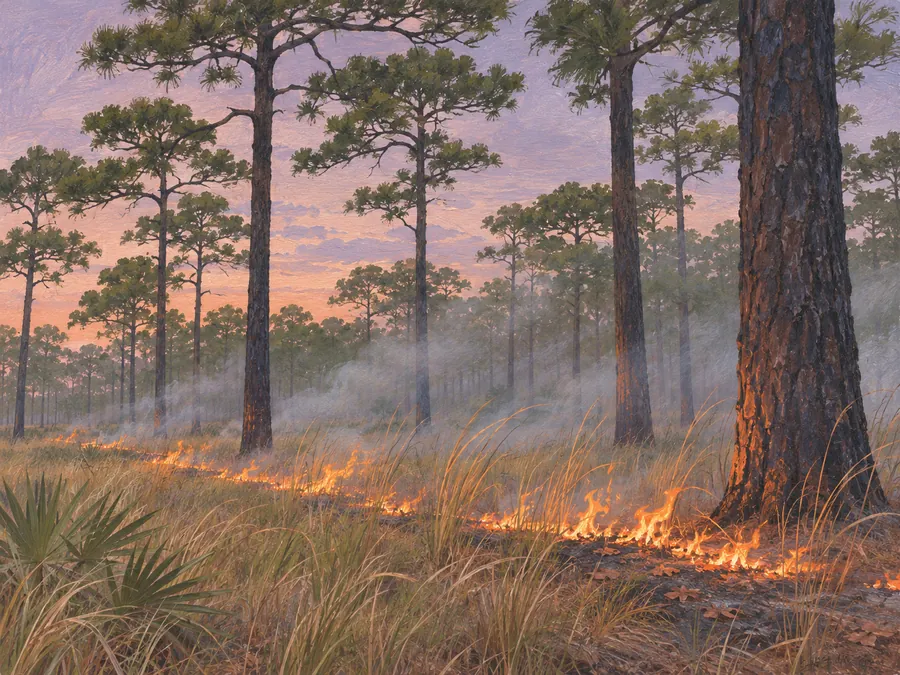
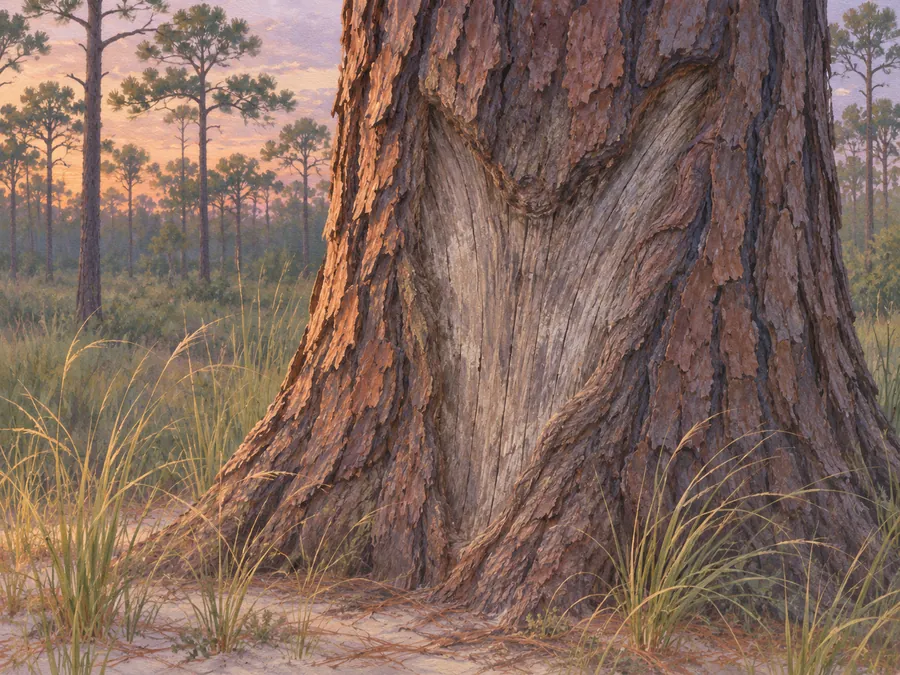
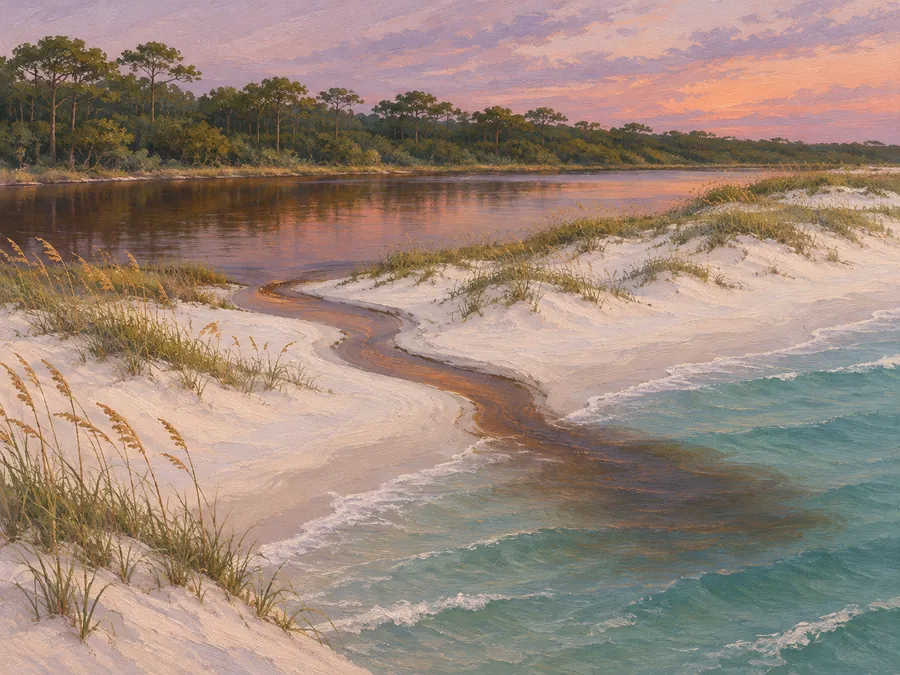
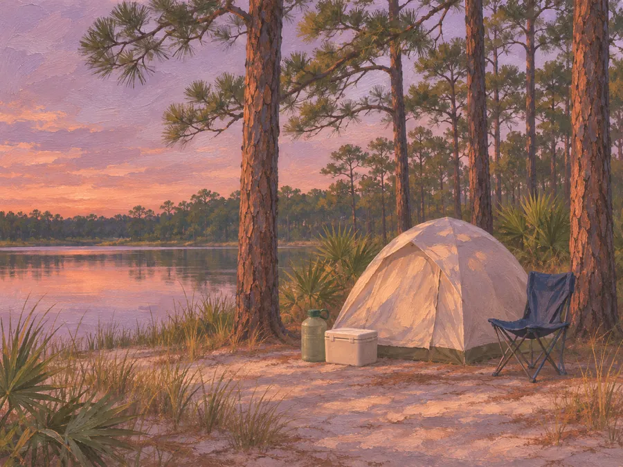
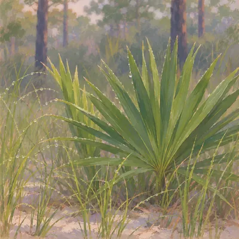
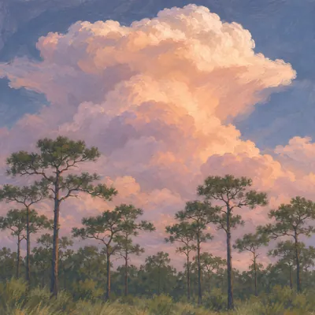
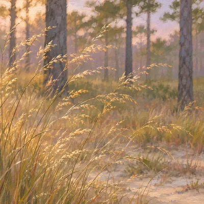
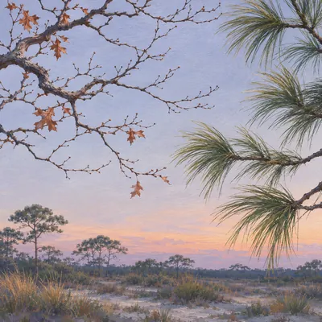
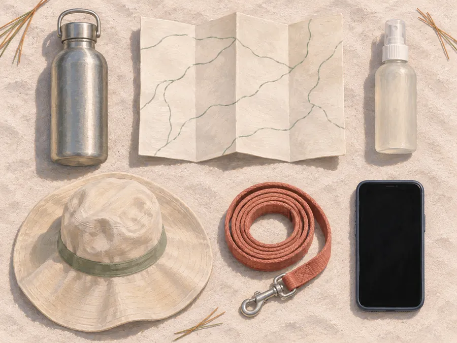


PAGE BRIEF
Primary keyword: Point Washington Wildlife Management Area
Related keywords: Point Washington State Forest, Eastern Lake Trail, Point Washington hiking trails, Longleaf Greenway Trail, Point Washington State Forest camping
Purpose: Visitor guide (Insights). Answer first, then trail choice, trailheads, habitats, history, Eastern Lake, camping, safety, and FAQs.
Interactive parts (trail chooser, map, habitat dots, checklist) are in assets/js/point-washington.js. Every word stays in this file, so the page reads fully without JavaScript.
Facts checked November 19, 2026. Recheck fees, hunting dates, closures, and facilities each season.


Point Washington Wildlife Management Area is a state wildlife and hunting area inside Point Washington State Forest, a protected forest of about 15,000 acres in southern Walton County. It sits north of Blue Mountain, Grayton, and Seagrove beaches, between US 98 and Scenic Highway 30A [[3]](#ref-3). People come for the 11-mile Eastern Lake trail system, an 8-mile greenway through old longleaf pines, primitive camping by Eastern Lake, and spring birding.

Two things surprise first-time visitors. The forest has no beach, and its trails are natural sand with few facilities. And the forest office on US 98 is not a trailhead, so set your map to one of the four trailheads below.

By Ben Slaughter. Researched from Florida Forest Service, FWC, and Choctawhatchee Basin Alliance documents. Facts checked November 19, 2026. Images on this page are AI-generated illustrations.

**A note from us:** 30A Digital Marketing is a marketing agency for Gulf Coast businesses, and we're always glad to send people toward the forests, lakes, and trails along 30A. Guides like this one are also the kind of local content we write for clients, such as rental companies that help guests plan their stay.

<aside class="pw-facts" aria-labelledby="pw-facts-title">

Quick Facts

<dl>

<dt>Location</dt><dd>Southern Walton County, north of Blue Mountain, Grayton, and Seagrove beaches</dd>

<dt>Managed by</dt><dd>Florida Forest Service (land, trails, fees, and camping) and FWC (hunting and wildlife rules)</dd>

<dt>Size</dt><dd>State forest: about 15,000 acres. WMA: more than 12,000 acres.</dd>

<dt>Hours</dt><dd>Sunrise to sunset, every day</dd>

<dt>Day-use fee</dt><dd>$2 per person at fee areas, free for children 6 and under. A $45 annual pass covers up to six people.</dd>

<dt>Main trailhead</dt><dd>Eastern Lake Trailhead on South County Road 395</dd>

<dt>Trails</dt><dd>Eastern Lake loops of 3.5, 6, and 11 miles; 8-mile Longleaf Greenway; 30A Trail; McQuage Bayou Multi-Use Trail</dd>

<dt>Dogs</dt><dd>Allowed on a leash or other physical restraint</dd>

<dt>Camping</dt><dd>Primitive tent sites on Eastern Lake, by reservation only</dd>

<dt>Phone</dt><dd><a href="tel:+18502678325">(850) 267-8325</a></dd>

</dl>
</aside>

<nav class="quick-links" aria-label="Quick links">

Quick Links

<ul>
<li><a href="#what-it-is">What Point Washington Wildlife Management Area Is</a></li>
<li><a href="#trailheads">Trailheads, Parking, and Directions</a></li>
<li><a href="#choose-your-trail">Choose Your Trail</a></li>
<li><a href="#activities">Activities Allowed on Each Trail</a></li>
<li><a href="#habitats-wildlife">Habitats, Wildlife, and Rare Plants</a></li>
<li><a href="#fire-history">Fire, Old Pines, and the Forest's Past</a></li>
<li><a href="#eastern-lake">Eastern Lake and Its Opening to the Gulf</a></li>
<li><a href="#camping">Camping at Eastern Lake</a></li>
<li><a href="#seasons-safety">Seasons, Hunting, and Trail Safety</a></li>
<li><a href="#accessibility">Accessibility and Facilities</a></li>
<li><a href="#paddling-beaches">Nearby Paddling and Beaches</a></li>
<li><a href="#checklist">Before You Go Checklist</a></li>
<li><a href="#faq">Common Questions about Point Washington</a></li>
</ul>
</nav>

## What Point Washington Wildlife Management Area Is {#what-it-is}

Point Washington has two names because it's managed by two agencies. The Florida Forest Service takes care of the trails, roads, timber, prescribed burns, fees, and camping. And the Florida Fish and Wildlife Conservation Commission (FWC) sets the hunting, fishing, and wildlife rules for the wildlife management area (WMA) [[1]](#ref-1) [[3]](#ref-3).

The WMA covers more than 12,000 acres of the state forest, including sandhill, titi swamps, wet prairie, and cypress swamps [[3]](#ref-3). Published figures for the whole forest range from about 15,000 to 15,400 acres, so we round to about 15,000.

<figure class="pw-diagram pw-names">
<svg viewBox="0 0 420 330" role="img" aria-labelledby="pw-names-title pw-names-desc">
<title id="pw-names-title">Two names, one forest</title>
<desc id="pw-names-desc">A large outer shape labeled Point Washington State Forest, managed by the Florida Forest Service for land, trails, fees, and camping. Inside it, a slightly smaller shape labeled Point Washington Wildlife Management Area, where FWC sets hunting, fishing, and wildlife rules.</desc>
<rect x="6" y="6" width="408" height="318" rx="20" fill="#EAE3D3" stroke="#CFC3AA" stroke-width="2"/>
<text x="26" y="44" class="pw-svg-head">Point Washington State Forest</text>
<text x="26" y="70" class="pw-svg-sub">About 15,000 acres · Florida Forest Service</text>
<text x="26" y="92" class="pw-svg-sub">Land, trails, fees, camping</text>
<rect x="48" y="118" width="346" height="184" rx="16" fill="#F4F0E7" stroke="#C66D54" stroke-width="2"/>
<text x="70" y="158" class="pw-svg-head">Wildlife Management Area</text>
<text x="70" y="184" class="pw-svg-sub">More than 12,000 acres · FWC</text>
<text x="70" y="206" class="pw-svg-sub">Hunting, fishing, wildlife rules</text>
<text x="70" y="276" class="pw-svg-note">Not to scale</text>
</svg>
<figcaption>The WMA covers most of the state forest. Check both agencies' rules before you go.</figcaption>
</figure>

The state bought the land on May 19, 1992, through Florida's Conservation and Recreation Lands program. The Florida Forest Service took charge of 15,181 acres [[1]](#ref-1). Grayton Beach State Park, Deer Lake State Park, and Topsail Hill Preserve State Park sit nearby [[2]](#ref-2).

A state forest is not a state park. Expect sand roads, natural trails, a few restrooms at trailheads, and no stores, beach, or dune land [[7]](#ref-7).

## Trailheads, Parking, and Directions {#trailheads}

The forest's official map names four trailheads: Eastern Lake, 30A, Longleaf Greenway, and McQuage Bayou [[2]](#ref-2). Pick your trail first, then drive to the trailhead that serves it.

<button type="button" class="is-active" data-q="Point Washington State Forest, Santa Rosa Beach, FL">Whole forest</button>
<button type="button" data-q="Point Washington State Forest Eastern Lake Trailhead, Santa Rosa Beach, FL">Eastern Lake</button>
<button type="button" data-q="4695 E County Hwy 30A, Santa Rosa Beach, FL 32459">30A</button>
<button type="button" data-q="Longleaf Pine Trailhead, Satinwood Dr, Santa Rosa Beach, FL">Longleaf Greenway</button>
<button type="button" data-q="McQuage Bayou Trailhead, Point Washington State Forest, FL">McQuage Bayou</button>

The map loads from Google Maps when you open it.

<button type="button" class="btn-solid" data-pw-map-open>Show map</button>
<noscript>
Turn on JavaScript to see the map, or use the directions links below.
</noscript>

<ul class="pw-trailheads">
<li>
<h3>Eastern Lake Trailhead</h3>

South County Road 395, about 1.1 miles south of US 98

<strong>Best for:</strong> the three Eastern Lake loops and the east end of the Longleaf Greenway.

<strong>Facilities:</strong> large lot, restroom, picnic tables [<a href="#ref-1">1</a>].

<a class="link-caps" href="https://www.google.com/maps/dir/?api=1&amp;destination=Point+Washington+State+Forest+Eastern+Lake+Trailhead%2C+Santa+Rosa+Beach%2C+FL">Get directions</a>
</li>
<li>
<h3>30A Trailhead</h3>

4695 E. County Highway 30A, at Greenway Station in Seagrove

<strong>Best for:</strong> short walks and families staying on 30A.

<strong>Facilities:</strong> parking, restrooms, picnic tables, bike racks [<a href="#ref-11">11</a>].

<a class="link-caps" href="https://www.google.com/maps/dir/?api=1&amp;destination=4695+E+County+Hwy+30A%2C+Santa+Rosa+Beach%2C+FL+32459">Get directions</a>
</li>
<li>
<h3>Longleaf Greenway Trailhead</h3>

End of Satinwood Drive off 30A, Blue Mountain Beach

<strong>Best for:</strong> the west end of the Longleaf Greenway.

<strong>Facilities:</strong> parking. Other facilities not confirmed.

<a class="link-caps" href="https://www.google.com/maps/dir/?api=1&amp;destination=Longleaf+Pine+Trailhead%2C+Satinwood+Dr%2C+Santa+Rosa+Beach%2C+FL">Get directions</a>
</li>
<li>
<h3>McQuage Bayou Trailhead</h3>

Off County Road 283, north of US 98

<strong>Best for:</strong> horseback riding, plus hiking and biking.

<strong>Facilities:</strong> trailhead parking. Other facilities not confirmed.

<a class="link-caps" href="https://www.google.com/maps/dir/?api=1&amp;destination=McQuage+Bayou+Trailhead%2C+Point+Washington+State+Forest%2C+FL">Get directions</a>
</li>
</ul>

Don't navigate to the forest office at 5865 E. US Highway 98 for a hike. It is an office, not a trail start.

Download the [official forest map (PDF)](https://ccmedia.fdacs.gov/content/download/43250/file/PointWashingtonstateforest-entireforest.pdf) and save it to your phone before you leave. It shows every trail, trailhead, restroom, and public entrance [[2]](#ref-2).

## Choose Your Trail {#choose-your-trail}

Start on the Eastern Lake Trail system for the widest choice: loops of about 3.5, 6, and 11 miles leave from one trailhead [[2]](#ref-2). Families staying on 30A can start closer to the beach on the 30A Trail. Riders head to McQuage Bayou, the only trail open to horses [[1]](#ref-1).

Find Your Trail

<fieldset>
<legend>How much time do you have?</legend>
<label><input type="radio" name="pw-time" value="short"> Under 1 hour</label>
<label><input type="radio" name="pw-time" value="mid"> 1 to 3 hours</label>
<label><input type="radio" name="pw-time" value="long"> Half a day or more</label>
</fieldset>
<fieldset>
<legend>How are you getting around?</legend>
<label><input type="radio" name="pw-mode" value="walk"> Walking</label>
<label><input type="radio" name="pw-mode" value="bike"> Biking</label>
<label><input type="radio" name="pw-mode" value="horse"> Horseback</label>
</fieldset>
<fieldset>
<legend>Who's coming?</legend>
<label><input type="radio" name="pw-who" value="kids"> Kids</label>
<label><input type="radio" name="pw-who" value="dog"> A dog</label>
<label><input type="radio" name="pw-who" value="birds"> Birders</label>
<label><input type="radio" name="pw-who" value="solo"> Just me</label>
</fieldset>

Pick an answer in each row, and the trails that fit move to the top.

Times are our estimate: about 2 miles an hour walking, 3 on horseback, and 6 biking on sand. Your pace may differ.

<ul class="pw-trails" data-pw-trails>
<li data-trail="30a">
<h3>30A Trail</h3>

About 0.75 mile each way · Starts at the 30A Trailhead · Foot and bike

The 30A Trail starts at the 30A Trailhead in Seagrove and runs north into the forest, past the Eastern Lake campsites, to the Eastern Lake loops. It is about three-quarters of a mile each way, or 1.5 miles there and back [<a href="#ref-15">15</a>] [<a href="#ref-11">11</a>]. Turn around at the campground for a short family walk, or keep going to join a loop.

</li>
<li data-trail="el-short">
<h3>Eastern Lake Trail: The 3.5-Mile Loop</h3>

About 3.5 miles · Starts at the Eastern Lake Trailhead · Foot and bike

The short loop is the easiest full loop in the forest. In spring, walk the southern half quietly. Bachman's sparrows sing there from April through June, in open patches of wiregrass and saw palmetto [<a href="#ref-6">6</a>]. Bring water even for this loop.

</li>
<li data-trail="el-mid">
<h3>Eastern Lake Trail: The 6-Mile Loop</h3>

About 6 miles · Starts at the Eastern Lake Trailhead · Foot and bike

The middle loop adds wetter ground and creek crossings. Bird checklists for the forest point to the crossings of Peach Creek on the longer loops for songbirds and red-shouldered hawks [<a href="#ref-13">13</a>]. Plan about three hours on foot by our estimate.

</li>
<li data-trail="el-full">
<h3>Eastern Lake Trail: The 11-Mile Loop</h3>

About 11 miles · Starts at the Eastern Lake Trailhead · Foot and bike

The full loop takes most of a day on foot, so start early and carry more water than you think you need. Cyclists use it for a longer sandy ride. Follow the colored blazes and check the trailhead map before you set out.

</li>
<li data-trail="greenway">
<h3>Longleaf Greenway Trail</h3>

About 8 miles one way · Starts at Satinwood Drive or the Eastern Lake Trailhead · Foot and bike

The Longleaf Greenway is about 8 miles long and runs one way, not as a loop. It links the Eastern Lake Trailhead with a trailhead at the end of Satinwood Drive in Blue Mountain Beach [<a href="#ref-1">1</a>]. Road crossings split it into stretches of about 2.25, 2.5, and 3.25 miles [<a href="#ref-2">2</a>], so you can walk out and back on one stretch. It passes a stand of old-growth longleaf pines, some still scarred from early turpentine collecting [<a href="#ref-1">1</a>].

</li>
<li data-trail="mcquage">
<h3>McQuage Bayou Multi-Use Trail</h3>

3- or 5-mile loops · Starts at the McQuage Bayou Trailhead · Horse, foot, and bike

McQuage Bayou, north of US 98, has two loops, east and west, for rides of about three or five miles [<a href="#ref-1">1</a>]. It is the only trail in the forest open to horses. Hikers and cyclists use it too [<a href="#ref-2">2</a>].

</li>
</ul>

The trails are flat and sandy. Sand turns soft in dry spells, and low spots hold water after rain, because about 30% of the forest is wetland [[7]](#ref-7). Wear shoes you don't mind getting wet.

## Activities Allowed on Each Trail {#activities}

Hiking and biking are allowed on every trail system, horses only at McQuage Bayou, and ATVs nowhere in the forest [[1]](#ref-1).

| Trail | Hiking | Biking | Horses | Leashed dogs | Motor vehicles |
|---|---|---|---|---|---|
| Eastern Lake loops | Yes | Yes | No | Yes | No |
| 30A Trail | Yes | Yes | No | Yes | No |
| Longleaf Greenway | Yes | Yes | No | Yes | No |
| McQuage Bayou | Yes | Yes | Yes | Yes | No |
| Open forest roads | Yes | Yes | No | Yes | Licensed vehicles only |

- **ATVs and unlicensed vehicles** are not allowed anywhere. Licensed cars and trucks may use designated open forest roads only [[1]](#ref-1).
- **Dogs** must be under physical restraint at all times, and they can't chase or bother wildlife. They are not allowed in areas FWC posts as closed [[3]](#ref-3).
- **After dark:** trails close at sunset. Staying later takes a State Forest Use Permit from the forest office [[1]](#ref-1).
- **Trash:** carry out everything you bring. Don't bury or burn it [[1]](#ref-1).
- **Fishing and hunting** follow FWC rules [[1]](#ref-1). For paddling and fishing on Eastern Lake, see [Nearby Paddling and Beaches](#paddling-beaches).

## Habitats, Wildlife, and Rare Plants {#habitats-wildlife}

Point Washington mixes 10 natural communities, so a single walk can cross dry sandy hills, open pine flatwoods, wet prairie, and dark swamp [[1]](#ref-1). Each one holds different plants and animals.

### Habitats You'll Walk Through

<figure class="pw-habitat" data-pw-habitat>

<button type="button" class="pw-dot" style="left:7%" data-zone="sandhill" aria-label="Sandhill">1</button>
<button type="button" class="pw-dot" style="left:22%" data-zone="flatwoods" aria-label="Flatwoods">2</button>
<button type="button" class="pw-dot" style="left:38%" data-zone="prairie" aria-label="Wet prairie">3</button>
<button type="button" class="pw-dot" style="left:54%" data-zone="swamp" aria-label="Basin swamp and titi drains">4</button>
<button type="button" class="pw-dot" style="left:71%" data-zone="cypress" aria-label="Cypress swamp">5</button>
<button type="button" class="pw-dot" style="left:92%" data-zone="lake" aria-label="Coastal dune lake">6</button>

<figcaption>Tap a number to read about that habitat. Illustration, AI-generated; not to scale.</figcaption>
</figure>

<ul class="pw-zones">
<li id="zone-sandhill" data-zone="sandhill">1<strong>Sandhill:</strong> dry, white-sand rises with longleaf pine, turkey oak, and wiregrass. Gopher tortoises dig here.</li>
<li id="zone-flatwoods" data-zone="flatwoods">2<strong>Mesic and wet flatwoods:</strong> flat pine woods over saw palmetto and wiregrass, damp after rain.</li>
<li id="zone-prairie" data-zone="prairie">3<strong>Wet prairie:</strong> open, sunny, grassy wetland. White-topped pitcher plants grow in spots like this.</li>
<li id="zone-swamp" data-zone="swamp">4<strong>Basin swamp and titi drains:</strong> low, shaded wetland with titi shrubs and bay trees.</li>
<li id="zone-cypress" data-zone="cypress">5<strong>Cypress swamp:</strong> standing water and cypress trees.</li>
<li id="zone-lake" data-zone="lake">6<strong>Eastern Lake:</strong> a coastal dune lake at the forest's south edge (see <a href="#eastern-lake">Eastern Lake and Its Opening to the Gulf</a>).</li>
</ul>

About 30% of the forest is wetland, and most of that is basin swamp [[7]](#ref-7). That explains the wet trail spots after rain.

<figure class="chart chart-scaled" aria-labelledby="chart-habitat-title">
<figcaption class="chart-title" id="chart-habitat-title">Historical Habitat on the Forest, in Acres</figcaption>

Wet flatwoods3,816

Mesic flatwoods3,804

Sandhill2,714

Wet prairie939

Estimated historical extent from the forest's 2015 management plan [<a href="#ref-7">7</a>]. These are reconstructions of past conditions, not a current survey.

</figure>

### Birds to Watch and Hear

Point Washington is a site on the Great Florida Birding and Wildlife Trail [[3]](#ref-3). FWC lists the southeastern American kestrel, prothonotary warbler, myrtle warbler, red-headed woodpecker, mourning dove, and common ground-dove among its birds [[3]](#ref-3).

- **Spring:** listen for Bachman's sparrows from April through June on the southern half of the short Eastern Lake loop [[6]](#ref-6). They sing from low perches in wiregrass and palmetto and are easier to hear than to see.
- **Creek crossings:** the Peach Creek crossings on the longer loops are good stops for songbirds and red-shouldered hawks [[13]](#ref-13).
- **Log what you see:** add sightings to the forest's eBird hotspot, which helps biologists track birds over time [[3]](#ref-3).

### Gopher Tortoises and Black Bears

Gopher tortoises are a protected species here [[1]](#ref-1). They dig burrows in dry, sandy ground. Watch from the trail and leave burrow openings alone. Biologists have tracked tortoises on the forest by dividing their habitat into 33 survey areas and checking about a third of them each year [[7]](#ref-7).

Black bears live in this part of Walton County. Campers must store food properly, and day hikers should pack out every crumb [[10]](#ref-10).

### Curtiss' Sandgrass and Pitcher Plants

Curtiss' sandgrass, also called Florida sandreed, is a rare grass of sunny, damp ground [[16]](#ref-16). The Florida Forest Service says the region's population, including the one on this forest, is the largest in the world [[1]](#ref-1).

White-topped pitcher plants grow in open, wet, sunny spots. Their tall, trumpet-shaped leaves trap insects. When fire stays away too long, shrubs such as titi shade them out, which is one reason the forest uses prescribed burns [[7]](#ref-7). Enjoy them from the trail, and never dig or pick them.

<ul class="pw-species">
<li>
Bachman's sparrow

Plain, streaky brown sparrow. Listen for a clear whistle followed by a trill.

Spring · Wiregrass and palmetto
</li>
<li>
Southeastern American kestrel

Small falcon that perches on snags and power lines over open pine land.

Year-round · Open sandhill
</li>
<li>
Red-headed woodpecker

All-red head, black back, and big white wing patches that flash in flight.

Year-round · Open pines and snags
</li>
<li>
Prothonotary warbler

Bright golden-yellow bird of wet woods and creek edges.

Spring and summer · Swamps and creeks
</li>
<li>
Gopher tortoise

Look for the half-moon mouth of a burrow in dry sand, often with a sandy apron.

Year-round · Sandhill
</li>
<li>
White-topped pitcher plant

Tall trumpets with white, red-veined tops standing in open wet ground.

Spring through fall · Wet prairie
</li>
<li>
Curtiss' sandgrass

Tall, tough grass in sunny spots where dry ground meets wet ground.

Year-round · Upland and wetland edges
</li>
</ul>

## Fire, Old Pines, and the Forest's Past {#fire-history}

Blackened tree trunks along the trail are a sign of care, not damage. The Florida Forest Service sets planned, low fires (prescribed burns) to keep the forest healthy [[1]](#ref-1).

### Prescribed Fire

Longleaf pine forests evolved with frequent fire. Low fires clear shrubs, return nutrients to the soil, and keep the ground open and sunny for wiregrass, pitcher plants, and Curtiss' sandgrass. The forest's 2015 management plan counted about 11,821 acres of fire-dependent habitat and aimed to burn each area every three to four years on average [[7]](#ref-7). Follow any closure signs during or after a burn, and expect some trail sections to look charred for a while.

<figure class="article-figure">

<figcaption>A low, slow burn clears the ground layer and leaves the pines standing. AI-generated illustration.</figcaption>
</figure>

### Turpentine Scars on Old Longleaf Pines

The Longleaf Greenway passes a stand of old-growth longleaf pines that shows how Southern pine forests once looked [[1]](#ref-1). Some of these trees still carry scars from the early turpentine industry, when workers cut into living pines to collect resin [[1]](#ref-1). Look for flat, healed wounds low on the trunk. Please don't touch or climb them.

<figure class="article-figure">

<figcaption>What to look for: a flat, gray face of old wood edged by thick, regrown bark. AI-generated illustration.</figcaption>
</figure>

### From Timber Land to State Forest

This forest was not always protected. St. Joe Paper Company owned the land for more than 50 years, through 1986, and used it for heavy timber harvest and quail and deer management [[1]](#ref-1). The state bought it in 1992, and the Florida Forest Service has worked since then to restore longleaf pine and native groundcover.

People lived here long before the timber era. The management plan records nine archaeological and historic sites on the forest [[7]](#ref-7). Their locations are not public. If you find an artifact, leave it in place and tell the forest office.

<ol class="pw-timeline">
<li>Long before the timber era Native people leave a burial mound and other traces. Nine archaeological and historic sites are recorded today [<a href="#ref-7">7</a>].</li>
<li>Through 1986 St. Joe Paper Company owns the land for more than 50 years and harvests timber [<a href="#ref-1">1</a>].</li>
<li>May 19, 1992 Florida buys the land, and Point Washington State Forest begins [<a href="#ref-1">1</a>].</li>
<li>2015 A ten-year management plan sets goals for fire, wildlife, and recreation [<a href="#ref-7">7</a>].</li>
<li>2024 The 30A Trailhead opens in Seagrove [<a href="#ref-11">11</a>].</li>
</ol>

## Eastern Lake and Its Opening to the Gulf {#eastern-lake}

Eastern Lake is a coastal dune lake: a shallow lake behind the beach dunes that sometimes breaks through the sand and connects to the Gulf. South Walton has 15 named coastal dune lakes along 26 miles of coast, and in Florida these lakes occur only in the Panhandle [[14]](#ref-14).

Eastern Lake covers about 74 acres and sits only about 200 meters (roughly 650 feet) from the Gulf [[8]](#ref-8). Scenic 30A crosses it on a bridge, splitting the lake into north and south parts [[9]](#ref-9).

After heavy rain or a storm, the lake rises until water cuts a channel, called an outfall, through the beach to the Gulf. Fresh water drains out and salt water can flow in. Later, waves and sand close the channel again [[9]](#ref-9) [[14]](#ref-14). That cycle makes the water brackish, a mix of fresh and salt, so the lake can hold both freshwater and saltwater life.

<figure class="pw-diagram pw-outfall">

<svg viewBox="0 0 350 245" role="img" aria-labelledby="pw-outfall-a-title"><title id="pw-outfall-a-title">Outfall closed: the lake sits behind a sand berm, separate from the Gulf.</title>
<text x="20" y="40" class="pw-svg-head">Outfall closed</text>
<path d="M20 120 Q60 114 100 120 Q125 123 150 122 L150 200 H20 Z" fill="#9C8670"/>
<path d="M240 152 Q285 144 330 152 L330 200 H240 Z" fill="#6E9A9F"/>
<path d="M136 124 Q170 82 204 112 Q226 132 246 152 L246 200 H136 Z" fill="#EAE3D3" stroke="#CFC3AA" stroke-width="1.5"/>
<text x="56" y="228" class="pw-svg-sub">Lake</text>
<text x="160" y="228" class="pw-svg-sub">Sand berm</text>
<text x="272" y="228" class="pw-svg-sub">Gulf</text>
</svg>
<svg viewBox="0 0 350 245" role="img" aria-labelledby="pw-outfall-b-title"><title id="pw-outfall-b-title">Outfall open: a channel cuts through the berm and lake water flows into the Gulf.</title><defs><marker id="pw-arrow" viewBox="0 0 10 10" refX="8" refY="5" markerWidth="7" markerHeight="7" orient="auto"><path d="M0 0 L10 5 L0 10 Z" fill="#C66D54"/></marker></defs>
<text x="20" y="40" class="pw-svg-head">Outfall open</text>
<path d="M20 126 Q60 120 100 126 Q125 129 150 128 L150 200 H20 Z" fill="#9C8670"/>
<path d="M240 152 Q285 144 330 152 L330 200 H240 Z" fill="#6E9A9F"/>
<path d="M146 128 L246 152 L246 200 H146 Z" fill="#9C8670"/>
<path d="M136 130 Q156 96 176 116 L176 200 H136 Z" fill="#EAE3D3" stroke="#CFC3AA" stroke-width="1.5"/>
<path d="M206 124 Q226 120 246 152 L246 200 H206 Z" fill="#EAE3D3" stroke="#CFC3AA" stroke-width="1.5"/>
<path d="M110 104 Q190 104 262 136" fill="none" stroke="#C66D54" stroke-width="2.5" marker-end="url(#pw-arrow)"/>
<text x="56" y="228" class="pw-svg-sub">Lake</text>
<text x="166" y="228" class="pw-svg-sub">Channel</text>
<text x="272" y="228" class="pw-svg-sub">Gulf</text>
</svg>

<figcaption>Closed: the lake sits behind the beach. Open: after high water, a channel cuts through and lake water runs to the Gulf. Not to scale.</figcaption>
</figure>

<figure class="article-figure">

<figcaption>A coastal dune lake with its outfall open to the Gulf. AI-generated illustration, not Eastern Lake itself.</figcaption>
</figure>

For the Curious: Eastern Lake by the Numbers

<ul>
<li><strong>Size:</strong> about 74 acres (30 hectares) and about 530,000 cubic meters of water, based on 2024 measurements [<a href="#ref-8">8</a>].</li>
<li><strong>Saltiness:</strong> the lake's long-term average salinity is 11.85 parts per thousand (ppt). Surface samples in 2024 averaged 16.37 ppt [<a href="#ref-8">8</a>]. These come from different data sets, so they don't show a trend.</li>
<li><strong>Algae:</strong> in summer 2024, testers rated the lake low in algae growth (oligotrophic) [<a href="#ref-8">8</a>].</li>
<li><strong>Mud as a history book:</strong> a University of Florida study dated a layer about 30 centimeters down in the lake's mud to about 1866 [<a href="#ref-9">9</a>].</li>
</ul>
<figure class="chart chart-scaled" aria-labelledby="chart-salinity-title">
<figcaption class="chart-title" id="chart-salinity-title">How Salty Is Eastern Lake?</figcaption>

Eastern Lake, long-term average11.85 ppt

Eastern Lake, 2024 surface average16.37 ppt

Typical seawaterabout 35 ppt

Lake figures from the Choctawhatchee Basin Alliance [<a href="#ref-8">8</a>]. Fresh water is close to 0 ppt. Typical open-ocean seawater is about 35 ppt.

</figure>

These figures describe water chemistry, not swimming safety. Check Walton County beach and water advisories before you swim or paddle.

## Camping at Eastern Lake {#camping}

You can camp at Point Washington only at the primitive tent sites on Eastern Lake, and only with a reservation. Book through the Florida State Forests site on ReserveAmerica or by calling the forest at (850) 267-8325 [[10]](#ref-10). There is no walk-up or roadside camping.

<figure class="article-figure">

<figcaption>Primitive means you bring your own water, shelter, and food storage. AI-generated illustration.</figcaption>
</figure>

"Primitive" means you bring nearly everything:

- **No running water and no electricity.** Bring all the water you'll drink, cook with, and wash with [[10]](#ref-10).
- **Tents only.** No RVs or trailers [[10]](#ref-10).
- **Shared outhouse,** not a bathhouse [[10]](#ref-10).
- **Bear rules.** Black bears live here. Store food, trash, and coolers in your vehicle or a bear-resistant container, never in your tent [[10]](#ref-10).
- **Fire rules.** Follow the campfire rules on your reservation, and check for burn bans during dry spells [[10]](#ref-10).

The campsites are reached by sandy forest roads. Your reservation lists directions, site details, and stay limits. The state's posted fee schedule lists primitive camping at $10 per site for up to five people [[5]](#ref-5); check the current nightly rate when you book.

Camping Pack List

<ul>
<li><label><input type="checkbox"> Tent and sleeping gear</label></li>
<li><label><input type="checkbox"> All the water you'll need</label></li>
<li><label><input type="checkbox"> Food in a sealed cooler</label></li>
<li><label><input type="checkbox"> Trash bags to pack everything out</label></li>
<li><label><input type="checkbox"> Headlamp or flashlight</label></li>
<li><label><input type="checkbox"> Bug spray and sun protection</label></li>
<li><label><input type="checkbox"> First aid kit</label></li>
<li><label><input type="checkbox"> Printed reservation</label></li>
<li><label><input type="checkbox"> Offline copy of the forest map</label></li>
</ul>

## Seasons, Hunting, and Trail Safety {#seasons-safety}

Spring and fall bring the mildest hiking weather, but fall and winter also bring hunting seasons. Check the hunting calendar before any visit from fall through spring.

<ul class="pw-seasons">
<li>

Spring

Mild days and the best birding. Bachman's sparrows sing April through June [<a href="#ref-6">6</a>]. Spring turkey season may be open [<a href="#ref-4">4</a>].

</li>
<li>

Summer

Heat, humidity, biting insects, and afternoon thunderstorms. Hike early, carry extra water, and leave the trail when you hear thunder. Low spots stay wet after storms.

</li>
<li>

Fall

Cooler, drier trails. Several hunting seasons open [<a href="#ref-4">4</a>].

</li>
<li>

Winter

Cool, clear days and fewer bugs. Hunting seasons continue [<a href="#ref-4">4</a>].

</li>
</ul>

### Hunting Season Safety

Point Washington is an active wildlife management area. Its seasons include archery, muzzleloading gun, general gun, small game, and spring turkey [[4]](#ref-4). Dates change each year, so open FWC's current [regulations summary brochure for Point Washington WMA](https://app.myfwc.com/hgm/hgmsearch/wmad?brochureTitle=Point%20Washington) before you go [[4]](#ref-4).

**On hunt days,** stay on marked trails, keep dogs leashed, and wear a bright color so hunters can see you. Hunters, follow FWC's rules and permits for this WMA [[4]](#ref-4).

### Trail Safety

- **Water:** carry plenty of water, and more in summer. There is no drinking water on the trails.
- **Hours:** trails close at sunset [[1]](#ref-1). Start long loops early.
- **Navigation:** download the official map before you go [[2]](#ref-2). Sandy side paths and forest roads can look like trails.
- **Wildlife:** give gopher tortoises, snakes, and bears plenty of room. Never feed wildlife.
- **Burns and closures:** obey closure signs. The forest closes areas during prescribed burns.
- **Tell someone** your route and when you expect to be back.

## Accessibility and Facilities {#accessibility}

We found no trail at Point Washington that the state lists as wheelchair accessible. The trails are natural sand that can be soft when dry and wet after rain. For current access details, call the forest office at (850) 267-8325.

| Trailhead | Parking | Restroom | Picnic tables | Drinking water |
|---|---|---|---|---|
| Eastern Lake | Yes | Yes | Yes | Not confirmed |
| 30A | Yes | Yes | Yes | Not confirmed |
| Longleaf Greenway (Satinwood) | Yes | Not confirmed | Not confirmed | Not confirmed |
| McQuage Bayou | Yes | Not confirmed | Not confirmed | Not confirmed |

Sources: [[1]](#ref-1) [[11]](#ref-11).

The 30A Trailhead is the easiest place to start for visitors who want a short, flat walk close to parking and restrooms. Walk a few minutes in, then turn back whenever you like.

## Nearby Paddling and Beaches {#paddling-beaches}

The state forest has no beach of its own [[7]](#ref-7), but three state parks with Gulf beaches sit close by: Grayton Beach State Park, Deer Lake State Park, and Topsail Hill Preserve State Park [[2]](#ref-2). The forest's trail system also connects to Grayton Beach State Park [[6]](#ref-6). Each park sets its own fees and hours.

To get out on Eastern Lake, use Walton County's public boat ramp on the lake. The county lists it for kayaking, boating, fishing, and birding [[12]](#ref-12). Check the county's current parking and launch rules before you go. Fishing follows FWC rules [[1]](#ref-1).

A good half-day plan: walk the short Eastern Lake loop in the cool of the morning, then spend the afternoon at one of the beach parks.

## Before You Go Checklist {#checklist}

Run through this list the night before. Your checks save in this browser, and you can print the list.

<figure class="article-figure">

<figcaption>Water, a map, bug spray, sun protection, and a leash cover most visits. AI-generated illustration.</figcaption>
</figure>

Before You Go

<ul>
<li><label><input type="checkbox"> Pick a trail that fits your time and group.</label></li>
<li><label><input type="checkbox"> Save directions to the right trailhead, not the forest office.</label></li>
<li><label><input type="checkbox"> Have the day-use fee ready: $2 per person, free for kids 6 and under.</label></li>
<li><label><input type="checkbox"> From fall through spring, check FWC's hunting dates for Point Washington WMA.</label></li>
<li><label><input type="checkbox"> Check the weather. Skip the trail if storms are coming.</label></li>
<li><label><input type="checkbox"> Pack water, sun protection, and bug spray.</label></li>
<li><label><input type="checkbox"> Download the official forest map to your phone.</label></li>
<li><label><input type="checkbox"> Bring a leash and waste bags if your dog is coming.</label></li>
<li><label><input type="checkbox"> Plan to be back at your car before sunset.</label></li>
</ul>

<button type="button" class="btn-outline" data-pw-print>Print checklist</button>
<button type="button" class="btn-outline" data-pw-clear>Clear checks</button>

Fee and pass details: [[5]](#ref-5). Hunting dates: [[4]](#ref-4). Forest map: [[2]](#ref-2).

## Common Questions about Point Washington {#faq}

**What's the difference between Point Washington WMA and Point Washington State Forest?** They cover mostly the same land. Point Washington State Forest is managed by the Florida Forest Service, which runs the trails, fees, and camping. Point Washington Wildlife Management Area covers more than 12,000 acres of that forest, where FWC sets hunting, fishing, and wildlife rules.

**Is Point Washington Wildlife Management Area free to visit?** Not quite. Trailhead day-use areas charge $2 per person, and children 6 and under get in free. A $45 annual Florida State Forests pass covers up to six people. Campers pay a separate campsite fee.

**Where do you park for the Eastern Lake Trail?** Park at the Eastern Lake Trailhead on South County Road 395, about 1.1 miles south of US 98. It has a large lot, a restroom, and picnic tables. For a shorter start from the beach side, use the 30A Trailhead in Seagrove.

**What is the easiest trail at Point Washington?** The 30A Trail is the easiest, a flat walk of about three-quarters of a mile each way from the 30A Trailhead toward the Eastern Lake campsites. For a full loop, the 3.5-mile Eastern Lake loop is the shortest choice.

**How long is the Eastern Lake Trail?** The Eastern Lake Trail system has loops of about 3.5, 6, and 11 miles, all starting from the Eastern Lake Trailhead on County Road 395. The full system totals about 11 miles.

**Can you bring dogs to Point Washington State Forest?** Yes. Dogs must be on a leash or other physical restraint at all times, and they can't chase or bother wildlife. They are not allowed in areas FWC posts as closed.

**Can you camp at Point Washington State Forest?** Yes, at primitive tent sites on Eastern Lake, by reservation only. Book on the Florida State Forests ReserveAmerica site or by phone. Sites have no running water or electricity, and RVs are not allowed.

**Is it safe to hike during hunting season?** Yes, with care. Check FWC's current hunting dates for Point Washington WMA, stay on marked trails, keep dogs leashed, and wear a bright color so hunters can see you.

**Are there restrooms at Point Washington?** Yes, at some trailheads. The Eastern Lake and 30A trailheads both have restrooms. There are no restrooms along the trails, and campsites share an outhouse.

**Is Point Washington good for kids?** Yes, with the right trail. The 30A Trail is short and starts next to parking and restrooms. Older kids who walk well can handle the 3.5-mile Eastern Lake loop. Bring water, snacks, and bug spray.

**Is Point Washington wheelchair accessible?** We found no trail the state lists as wheelchair accessible. Trails are natural sand that can be soft or wet. Call the forest office at (850) 267-8325 for current access details before you visit.

**Does Point Washington State Forest have a beach?** No. The forest has no beach of its own. Grayton Beach, Deer Lake, and Topsail Hill Preserve state parks are nearby and each has Gulf beach access, with separate fees.

## References {#references}

Sources checked November 19, 2026.

<ol>
<li id="ref-1">Florida Forest Service, <a href="https://ccmedia.fdacs.gov/content/download/36370/file/pt-washington-state-forest-brochure.pdf"><em>Point Washington State Forest</em> brochure</a> (PDF)</li>
<li id="ref-2">Florida Forest Service, <a href="https://ccmedia.fdacs.gov/content/download/43250/file/PointWashingtonstateforest-entireforest.pdf"><em>Point Washington State Forest</em> map, December 2024</a> (PDF)</li>
<li id="ref-3">Florida Fish and Wildlife Conservation Commission, <a href="https://myfwc.com/recreation/cooperative/point-washington/"><em>Point Washington Wildlife Management Area</em></a></li>
<li id="ref-4">Florida Fish and Wildlife Conservation Commission, <a href="https://app.myfwc.com/hgm/hgmsearch/wmad?brochureTitle=Point%20Washington"><em>Regulations Summary Brochure: Point Washington WMA</em></a></li>
<li id="ref-5">Florida Forest Service, <a href="https://ccmedia.fdacs.gov/content/download/62942/file/fees_on_ffs_managed_lands.pdf"><em>Fees on Florida Forest Service Managed Lands</em></a> (PDF)</li>
<li id="ref-6">Great Florida Birding and Wildlife Trail, <a href="https://floridabirdingtrail.com/site/point-washington-state-forest/"><em>Point Washington State Forest</em></a></li>
<li id="ref-7">Florida Forest Service, <a href="https://www.fdacs.gov/content/download/76823/file/FINAL%20Point%20Washington%20State%20Forest%20LMP.pdf"><em>Ten-Year Land Management Plan for the Point Washington State Forest</em>, 2015</a> (PDF)</li>
<li id="ref-8">Choctawhatchee Basin Alliance, <a href="https://basinalliance.org/uploads/2025/12/Coastal-Dune-Lake-Annual-Report-Generation-PDF.pdf"><em>Coastal Dune Lake 2024 Water Chemistry Report</em></a> (PDF)</li>
<li id="ref-9">Foley, B., <a href="https://ufdcimages.uflib.ufl.edu/UF/E0/05/22/74/00001/FOLEY_B.pdf"><em>Paleolimnological Reconstructions of Two Coastal Dune Lakes in Northwest Florida</em>, University of Florida, 2018</a> (PDF)</li>
<li id="ref-10">Florida State Forests on ReserveAmerica, <a href="https://floridastateforests.reserveamerica.com/camping/eastern-lake-campground-1-point-washington--state-forest/r/facilityDetails.do?contractCode=FLFS&amp;parkId=1120118"><em>Eastern Lake Campground, Point Washington State Forest</em></a></li>
<li id="ref-11">WJHG, <a href="https://www.wjhg.com/2024/04/03/new-30a-trailhead-unveiled/"><em>New 30A Trailhead Unveiled</em>, April 3, 2024</a></li>
<li id="ref-12">Walton County, <a href="https://www.mywaltonfl.gov/DocumentCenter/View/3155/CDL-Public-Access"><em>Public Access Points on the Coastal Dune Lakes</em></a> (PDF)</li>
<li id="ref-13">Florida Forest Service, <a href="https://www.fdacs.gov/content/download/4895/file/pt-washington-bird-checklist.pdf"><em>Point Washington State Forest Checklist of Birds</em></a> (PDF)</li>
<li id="ref-14">Choctawhatchee Basin Alliance and Florida LAKEWATCH, <a href="https://lakewatch.ifas.ufl.edu/media/lakewatchifasufledu/extension/lake-management-plans/dune-lake/Dune-Lake-Appendix-I-copy.pdf"><em>Findings from Workshops on Walton County Coastal Dune Lakes</em>, 2008</a> (PDF)</li>
<li id="ref-15">Florida Forest Service, <a href="https://www.fdacs.gov/content/download/36370/file/point-washington-state-forest-brochure.pdf"><em>Point Washington State Forest</em> brochure, October 2026 revision</a> (PDF)</li>
<li id="ref-16">Atlas of Florida Plants, <a href="https://florida.plantatlas.usf.edu/plant/species/1086"><em>Sporobolus vaseyi: Florida Sandreed, Curtiss' Sandgrass</em></a></li>
</ol>

