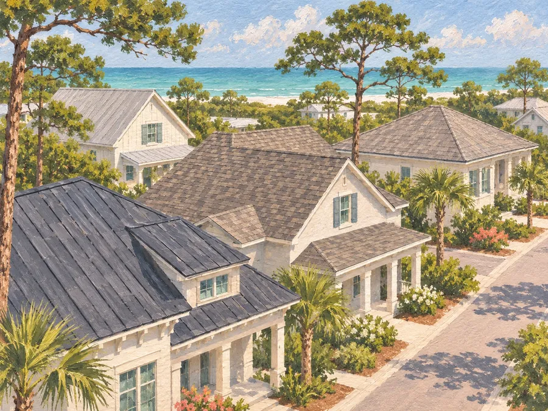


PAGE BRIEF
Primary keyword: roofing seo
Related keywords: roofing seo Florida, seo for roofing companies, roofing company seo, seo for roofers
Sister pages: /industries/home-services/, /insights/ai-seo-small-business/


Roofing SEO helps Florida contractors appear in Google Search, Google Maps, and AI-generated answers. But visibility only matters if it brings jobs your crews can handle at a margin worth earning.

At 30A Digital Marketing, we build SEO plans around the work you want, whether that's roof replacements, repairs, inspections, or commercial contracts. We focus on Florida's Gulf Coast and look beyond rankings to qualified calls, booked estimates, and signed jobs.

Everybody knows you need a complete Google Business Profile, useful service pages, customer reviews, and a healthy website. We'll review that. Then we'll cover the decisions generic roofing SEO guides miss:

- [Which searches attract your most profitable jobs](#jobs)
- [How Florida hurricane research can improve your content](#florida-content)
- [When to publish storm pages and what Florida advertising law requires](#storm-pages)
- [How to earn trust with out-of-state owners, property managers, and HOA boards](#remote-owners)
- [How to calculate whether you should do SEO yourself or hire professionals](#roi)

## What AI Overviews Miss about Roofing SEO {#ai-overview}

An AI summary of "roofing SEO" usually covers the basics. Some advice is sound; some gets repeated as a rule when it isn't one. Either way, you won't learn which searches lead to jobs worth winning.

AI answers change by query and date. The statements below represent common recommendations, not a fixed Google response.

| Common advice | Our verdict | What matters in Florida |
| --- | --- | --- |
| Rank higher to get more homeowner leads. | Too narrow | A high ranking isn't a sale. Track qualified calls and signed contracts. Include commercial buyers, property managers, and HOA boards when they're part of your market. |
| Use roofing contractor as your primary Google Business Profile category. | Generally sound | Choose the category that best describes your main business. Add secondary categories only when they fit services you actually provide. |
| Upload 5–10 project photos each month and post weekly updates. | Overstated | Google does not prescribe those quotas. Local results depend mainly on relevance, distance, and prominence [[1]](#ref-1). Add real project photos because they show buyers what you do. |
| Ask customers for reviews. | Incomplete | Google prohibits incentives, selectively asking happy customers, and staff review quotas [[3]](#ref-3). Ask customers consistently and let them respond honestly. |
| Create a landing page for every city or neighborhood. | Risky | Google's spam rules cover doorway pages made to target similar searches [[2]](#ref-2). Publish a location page when you can show real projects, useful local details, and a clear reason that page exists. |
| Improve Core Web Vitals, use HTTPS, build citations, and earn industry backlinks. | Partly right | Speed, security, and crawlability help your site work. Genuine local links from suppliers, associations, community groups, or local news also help establish relevance and credibility. |
| Track rankings and map grids with tools such as BrightLocal or Ahrefs. | Useful, but incomplete | Visibility reports cannot tell you which calls turned into roofs. Connect call tracking with estimates and CRM records. |
| SEO agencies charge $1,000–$5,000+ a month. | Plausible broad range | Compare deliverables and reporting, not just the fee. An inexpensive plan that generates no qualified work is a waste of money. |
| DIY SEO training starts around $500 a month. | Misses labor costs | Software or training is only part of the expense. An owner's time is often scarcest during the busy season. |

**Other gaps matter in Florida:**

- **Storm advertising rules.** Florida Statute 489.147 restricts certain insurance-claim advertising and contractor conduct. Claim-related copy needs legal review [[4]](#ref-4).
- **Building-code changes.** The Florida Building Code, 9th Edition, is scheduled to take effect December 31, 2026. Permit, reroofing, and material pages need a code review [[8]](#ref-8).
- **Different job values.** A full replacement and a minor leak repair should not receive identical marketing priority.
- **Remote buyers.** Second-home owners, vacation rental managers, and HOA boards may select a roofer without visiting the job site.
- **A longer timeline.** SEO often takes six months or more to mature. Early progress may appear sooner, but your budget needs room for the full effort.
- **[AI search visibility](/services/ai-search-visibility/).** Clear service information, specific project evidence, and trustworthy sources make a page more useful to people and easier for search systems to interpret. None guarantees a mention in an AI answer, as our [prompt test of AI answers about Destin roofers](/insights/ai-seo-small-business/) showed.

<nav class="quick-links" aria-label="Quick links">

Quick Links

<ul>
<li><a href="#ai-overview">What AI Overviews Miss about Roofing SEO</a></li>
<li><a href="#basics">Roofing SEO Basics: What Every Contractor Needs</a></li>
<li><a href="#jobs">Rank for the Roofing Jobs You Want</a></li>
<li><a href="#florida-content">Florida Roofs Need Florida Evidence</a></li>
<li><a href="#storm-pages">Build Storm Pages before Hurricane Season</a></li>
<li><a href="#remote-owners">Win Roofing Jobs from Out-of-State Owners</a></li>
<li><a href="#roi">Roofing SEO ROI: What One More Roof Is Worth</a></li>
<li><a href="#diy">Roofing SEO Tasks You Can Do This Month</a></li>
<li><a href="#limits">The Limits of DIY Roofing SEO</a></li>
<li><a href="#work-with-us">Roofing SEO with 30A Digital Marketing</a></li>
<li><a href="#faq">Frequently Asked Questions about Roofing SEO</a></li>
</ul>
</nav>

## Roofing SEO Basics: What Every Contractor Needs {#basics}

Google says local rankings mainly depend on relevance, distance, and prominence [[1]](#ref-1). In essence: Does your business match the search? How close is it to the searcher? How established does it appear online?

Start with these six tasks:

1. **Google Business Profile.** Use the right primary category, accurate services and service areas, current hours, and genuine job photos. Accurate details help Google match the business to relevant searches and help customers decide whether to call.
2. **Service pages.** Give roof replacement, repair, metal roofing, inspections, and commercial roofing their own pages if you sell them. Different jobs involve different questions, budgets, and buying decisions.
3. **Reviews.** Invite genuine feedback from customers without incentives or filtering out unhappy people. Reviews give prospects third-party evidence of your work and can support local visibility [[1]](#ref-1), [[3]](#ref-3).
4. **Technical health.** Make your site secure, mobile-friendly, fast enough to use, and accessible to search engines. A page cannot earn inquiries if visitors cannot find it or use it.
5. **Local authority.** Seek [accurate mentions and useful links](/services/digital-authority/) from organizations that actually know your company. A local supplier or community organization can corroborate where you work.
6. **Tracking.** Record calls and forms by source, then match them to estimates and contracts. Otherwise, you can measure traffic but not business impact.

These tasks establish the foundation. Our [home services and contractor marketing page](/industries/home-services/) and [SEO service page](/services/seo/) cover the broader work. The decisions below determine where a roofing company should invest next.

## Rank for the Roofing Jobs You Want {#jobs}

Start with your job list, then choose keywords. A metal roof replacement and a small leak repair may both begin on Google, but they bring different revenue, margins, and demands on your crews.

Keyword research shows what people search for. Keyword selection decides which searches deserve your time and budget. Ask:

1. Which jobs earn the best margin?
2. Which jobs can your crews take in the next 90 days?
3. Where do you want more work?

For a Florida Panhandle contractor, those answers could produce this plan:

| Example search | Likely need | What the landing page should show |
| --- | --- | --- |
| metal roof replacement Destin | A high-value, planned project | Local project photos, material comparisons, financing details |
| roof repair Panama City Beach | A repair, often urgent | Tap-to-call number, truthful scheduling window, service area |
| roof inspection Santa Rosa Beach | An inspection before a sale, renewal, or storm season | Booking form and sample inspection report |
| commercial roofing Pensacola | A contractor for a building owner or manager | Credentials, relevant commercial work, named contact |
| roof leak repair near me | Immediate help | Accurate business hours and realistic response time |

If you want more replacements, prioritize replacement and material pages. If summer crews are booked, promote inspections to fill quieter weeks. The same list of keywords can support either strategy; your capacity decides which one makes sense.

Avoid driving emergency-repair calls when you cannot respond. Missed calls waste demand you've paid to attract, and slow responses can damage trust. Roofing company SEO should reflect the work you can deliver now, not just the searches you could rank for.

## Florida Roofs Need Florida Evidence {#florida-content}

Generic roofing content often ignores the conditions Florida homeowners face. Local research gives roofers a way to explain materials, roof shapes, and storm preparation with evidence instead of sales claims.

Hurricane Michael made landfall near Panama City on October 10, 2018, with sustained winds of about 160 mph. The Insurance Institute for Business & Home Safety (IBHS) examined 186 homes near landfall [[5]](#ref-5). Its investigators found:

- Most homes with asphalt shingles had roof-cover damage; fewer than half the homes with metal roofs did.
- Every investigated home with three-tab shingles had damage.
- Hip roofs performed better than gable roofs or mixed gable-hip designs.

<figure class="article-figure">

<figcaption>One Panhandle street can hold every roof type the Hurricane Michael research compared.</figcaption>
</figure>

FEMA also documented widespread problems with asphalt shingles after Michael [[6]](#ref-6). But metal is not an automatic winner in every case. A 2022 engineering study found fewer metal roof failures overall, but a greater share of severe failures among those that occurred [[7]](#ref-7).

**Why this matters:** A homeowner weighing metal against shingles needs more than a claim that one material is "best." Explain what the research observed, where it falls short, and what applies to that home's design and exposure.

That evidence can support useful Florida-specific pages:

- **Metal vs. shingles for Panhandle homes:** explain the Michael findings and their limits.
- **What a post-storm roof inspection checks:** show the areas beyond visible shingles, with example photos.
- **How roof shape affects wind damage:** explain hip and gable designs using your own projects.
- **Reroofing under the new Florida Building Code:** explain which changes affect your customers once the new edition takes effect.

The IBHS sample covers 186 homes after one exceptional storm. It reveals patterns, not the future performance of an individual roof. Cite the study, acknowledge that limit, add original job photos, and have a licensed roofer check the technical explanation. This gives readers verifiable information and gives search systems specific evidence to reference.

## Build Storm Pages before Hurricane Season {#storm-pages}

The Atlantic hurricane season runs from June 1 to November 30. Plan storm content during the quieter months, when your team can review it carefully. A page published in February has time to be discovered before the season; one written after landfall arrives when competitors are publishing and homeowners need immediate answers.

Prepare these pages and processes:

- **Storm damage and emergency repair:** explain the work you handle and the response times you can meet.
- **Post-storm inspections:** show what an inspection includes and provide a booking form.
- **Damage documentation:** explain how owners can photograph roof damage safely, without presenting insurance advice as roofing advice.
- **Emergency updates:** assign someone to update hours, capacity, and service areas within a day after a storm.

### Florida Law Restricts Storm and Insurance-Claim Advertising

Florida Statute 489.147 places specific limits on contractor advertising and insurance-related conduct [[4]](#ref-4). It does not ban every advertisement that mentions a roof insurance claim. Instead, an ad that encourages a consumer to contact a contractor or public adjuster to make a roof-damage claim can qualify as a prohibited advertisement if it omits the statute's required warnings. Those warnings cover the owner's deductible responsibility and the consequences of deductible fraud or false claims. The statute also specifies minimum disclosure sizing.

Contractors also may not:

- Offer a rebate, gift, cash, deductible waiver, or other benefit in exchange for permission to inspect a roof or for the homeowner making a claim.
- Offer or accept prohibited compensation or rewards for referrals tied to services payable from insurance proceeds.
- Interpret policy coverage, advise an insured about duties under the policy, or adjust a claim for the insured without the required public-adjuster license.
- Use an insurance-claim repair agreement without the detailed, good-faith estimate the law requires.

The law can apply to people acting on a contractor's behalf, including marketers. It also permits disciplinary action and fines of up to $10,000 per violation [[4]](#ref-4).

Ordinary ads for roofing services and storm repairs remain possible. However, claims such as "Free roof, your insurance pays" or "We'll cover your deductible" raise serious legal concerns. Review insurance-related pages, ads, and promotions with a Florida attorney before publishing. We are not lawyers, and this is not legal advice.

### Florida's New Building Code Is Scheduled for December 31, 2026

The Florida Building Code, 9th Edition, is scheduled to take effect December 31, 2026 [[8]](#ref-8). Before that date, have a qualified reviewer check pages covering permits, reroofing, wind requirements, and materials. For permits filed after the change, verify which edition the permitting authority applies. An outdated code reference can mislead a homeowner making an expensive decision.

## Win Roofing Jobs from Out-of-State Owners {#remote-owners}

Along [30A](/markets/30a-south-walton/), [Destin](/markets/destin-miramar-beach/), Santa Rosa Beach, and [Panama City Beach](/markets/panama-city-beach/), many properties belong to owners who live elsewhere. Second-home owners, vacation rental owners, property managers, and HOA boards may choose a roofer entirely online.

<figure class="article-figure">

<figcaption>For an owner who lives elsewhere, the inspection report and the video call stand in for a walk around the house.</figcaption>
</figure>

They need evidence before they can trust a contractor with a property they cannot easily visit. Some searches reflect that need:

- licensed roofer Destin
- roof inspection for a rental property in Santa Rosa Beach
- metal roofing contractor 30A
- commercial roofing Panama City Beach

### Show Remote Buyers What to Expect

Your website should answer the questions a local owner might ask face to face:

<ul class="limit-grid">
<li><strong>License verification</strong> Display your Florida license number and link to the state's license lookup.</li>
<li><strong>Nearby work</strong> Show real projects and name their neighborhoods, with the customer's permission.</li>
<li><strong>Inspection evidence</strong> Explain your process and provide a sample photo report.</li>
<li><strong>Remote approvals</strong> Describe how you share estimates, photos, video updates, and e-signatures.</li>
<li><strong>Communication</strong> Name a contact person and state a response window you can meet.</li>
<li><strong>Service coverage</strong> Make it easy to confirm you work at the property's address.</li>
</ul>

### Give Property Managers and HOA Boards Their Own Path

Property managers and HOA boards often compare several vendors, request insurance certificates, and need approvals from others. A dedicated commercial or association page should show relevant credentials, past projects, and a direct point of contact. It reduces the work required to shortlist you.

One manager or board may oversee several roofs. A clear process and reliable follow-through can turn one contract into repeat business. That makes this audience worth targeting even if its search volume is smaller than homeowner searches.

## Roofing SEO ROI: What One More Roof Is Worth {#roi}

Measure roofing SEO against gross profit from incremental jobs, not just leads or revenue. If an average signed roof brings $12,000 in revenue at a 30% margin, it contributes about $3,600 before your SEO fee. At $4,000 a month, you need slightly more than one additional roof per month to cover that fee.

Use this funnel:

**New inquiries × qualified rate × appointment rate × close rate × average contract value = booked revenue**

Then calculate: booked revenue × contribution margin − SEO fee = estimated net contribution after SEO cost.

*These examples are illustrations, not benchmarks, forecasts, or client results.*

| Step | Stronger scenario | Cautious scenario |
| --- | --- | --- |
| New search inquiries per month | 40 | 15 |
| Qualified inquiries | 60% = 24 | 50% = 7.5 |
| Inspections or estimates booked | 70% = 16.8 | 60% = 4.5 |
| Signed contracts | 30% = 5.04 roofs | 25% = 1.125 roofs |
| Average contract | $12,000 | $10,000 |
| Booked revenue | $60,480 | $11,250 |
| Contribution margin | 30% = $18,144 | 25% = $2,812.50 |
| After a $4,000 monthly SEO fee | $14,144 | −$1,187.50 |

The cautious scenario loses money at those assumptions. With a $10,000 contract and a 25% margin, a business needs 1.6 additional signed roofs a month to cover a $4,000 fee. Use your own average contract, close rate, and margin to establish a more useful target.

Two cautions matter:

- SEO often takes six months or more to mature. Early spending may precede results, so plan for that delay.
- Count only incremental demand. A previous customer who searches your company name before calling probably wasn't acquired by your new SEO work.

### What to Measure

| Measure | What it answers |
| --- | --- |
| Search impressions and rankings | Can buyers find you for the jobs you want? |
| Map visibility across your territory | Which areas can see your business in local results? |
| Search calls and form submissions | How many people contacted you? |
| Qualified inquiries | Which inquiries match your services and coverage? |
| Inspections and estimates booked | How many became real sales opportunities? |
| Signed contracts and revenue | What work did search contribute? |

The final two measures require records from your team. Call tracking and your estimate or CRM system let us connect a search inquiry to a signed job. That's how you judge whether to keep investing, shift toward a different service, or change the plan.

Estimate your break-even point with our [ROI calculator](/roi-calculator/) or [compare monthly plans](/plans/).

## Roofing SEO Tasks You Can Do This Month {#diy}

You can handle these basics without an agency. Each removes a common obstacle between a searcher and a call:

- Verify your Google Business Profile's primary category, hours, phone number, and service areas. Wrong details can cost you relevant calls.
- List the roofing services you actually provide, using language customers search for. This helps match your profile to their needs.
- Add photos from completed jobs and identify the neighborhood when appropriate. Local proof is more convincing than stock photography.
- Ask customers for honest reviews after a job. Never offer incentives or ask only satisfied customers.
- Reply briefly and professionally to positive and negative reviews. Show future buyers how you communicate.
- Open the site on your phone and tap the phone number. Confirm the call goes through.
- Show your Florida contractor license number where people can find it.
- Have a qualified person review your storm and insurance pages against Florida Statute 489.147.

If you want a broader starting point, try the [free SEO audit](/free-audit/).

## The Limits of DIY Roofing SEO {#limits}

Basic updates matter, but most competitors can make them too. More demanding work takes research, technical skill, or access to business records:

- **Strategy:** decide which services and locations deserve investment based on margin and crew availability.
- **Technical SEO:** fix site structure, indexing, speed, and structured data so important pages can be discovered and understood.
- **Original content:** combine credible studies, job photos, and licensed-roofer review to answer questions competitors haven't addressed well.
- **Compliance:** check storm and insurance content against Florida law and Google's policies before publication.
- **Attribution:** connect inquiries to appointments, contracts, and revenue rather than treating every call as a success.

The hardest constraint may be time. The owner handling estimates and crews often cannot also maintain a steady publishing and reporting schedule.

  

    Manage it yourself
    <h3>Compass</h3>
    
A business-specific AI-assisted content workflow and training. It costs $5,000 to set up, then $500 a month. You'll still review and publish the content; technical repairs, design, and link building fall outside that plan.

    <a class="btn-solid" href="/plans/diy-seo/">See Compass</a>
  

  

    Delegate the work
    <h3>Monthly Plans</h3>
    
Strategy, implementation, and reporting handled for you, from $4,000 a month. You approve changes and tell us which estimates closed.

    <a class="btn-solid" href="/plans/">See monthly plans</a>
  

## Roofing SEO with 30A Digital Marketing {#work-with-us}

We begin with research into your market, competitors, website, and most valuable opportunities. That first-month dossier guides roughly a year of work. We then build and improve the pages, local presence, and supporting authority your business needs.

Reporting goes beyond where you rank. We track search inquiries and, when your systems allow it, connect them to estimates and signed jobs. You provide project photos, approve changes, answer incoming leads, and tell us which estimates closed. We handle the ongoing research, implementation, and reporting; a brief monthly review keeps the plan tied to your business.

Our monthly plans start at $4,000. The first three months are month to month; if you choose to continue, the current plan structure moves to a nine-month agreement, followed by six-month terms. We're a remote agency focused on the Gulf Coast, so we don't charge to support a local office. Review [plans and pricing](/plans/) for current terms.

## See What We'd Fix First

[Book a free strategy call](/strategy-call/). We'll review how your roofing business appears in search and AI answers, with attention to your Business Profile, service pages, map coverage, and call tracking. We'll also flag storm-page claims that warrant legal review. You keep the findings whether we work together or not.

Prefer to look on your own first? Run the self-guided [free SEO audit](/free-audit/) and bring your notes to the call.

## Frequently Asked Questions about Roofing SEO {#faq}

**What is roofing SEO?** Roofing SEO helps a roofing company appear when potential customers search Google, Maps, or AI tools for roof repairs, replacements, inspections, and related services. A useful plan targets jobs the company wants and measures results through signed contracts.

**How much does roofing SEO cost in Florida?** Published pricing guides commonly describe agency retainers around $1,000–$5,000+ a month, though scope varies widely. Our [plans](/plans/) start at $4,000 a month, with the first three months billed month to month. The right budget depends on your website, competition, coverage area, and goals.

**How long does roofing SEO take?** Business Profile corrections and technical fixes may help sooner. A full program often needs six months or more to mature, especially where many contractors compete for the same searches. Monthly reporting should show whether visibility and qualified inquiries are improving along the way.

**Does my roofing company need a page for every city?** No. Create a location page when you can offer useful information about the area and show real work there. Google's doorway-abuse policy warns against near-identical pages targeting different place names [[2]](#ref-2). A few substantial pages can be more useful than dozens of thin ones.

**Should a roofer use SEO or Google Ads?** They solve different timing problems. Ads can reach customers quickly while you pay for placements; SEO takes longer but can continue bringing search traffic without paying for each click. Many roofing companies use [ads](/services/paid-advertising/) for near-term demand while building organic visibility.

**Is storm marketing legal for Florida roofers?** Yes, you can advertise roofing and storm-repair services. Florida Statute 489.147 regulates certain claim-oriented ads, requires disclosures in defined circumstances, and prohibits specific inducements and insurance-adjusting activity [[4]](#ref-4). Ask a Florida attorney to review claim-related promotions.

**Can I do roofing SEO myself?** Yes. Start with your Business Profile, service pages, reviews, and phone experience. Strategy, technical fixes, credible original content, compliance, and contract-level tracking take more effort. [Compass](/plans/diy-seo/) supports owners who want to run their own content workflow; [monthly plans](/plans/) cover ongoing agency execution.

## References {#references}

<ol>
<li id="ref-1">Google Business Profile Help, <a href="https://support.google.com/business/answer/7091?hl=en"><em>Tips to Improve Your Local Ranking on Google</em></a></li>
<li id="ref-2">Google Search Central, <a href="https://developers.google.com/search/docs/essentials/spam-policies"><em>Spam Policies for Google Web Search</em></a></li>
<li id="ref-3">Google Business Profile Help, <a href="https://support.google.com/contributionpolicy/answer/7400114"><em>Prohibited and Restricted Content</em></a></li>
<li id="ref-4">The Florida Senate, <a href="https://www.flsenate.gov/Laws/Statutes/2026/489.147"><em>2026 Florida Statutes, Section 489.147: Prohibited Property Insurance Practices; Contract Requirements</em></a></li>
<li id="ref-5">Insurance Institute for Business &amp; Home Safety, <a href="https://ibhs.org/wp-content/uploads/IBHS-Hurricane-Michael-Executive-Summary.pdf"><em>Hurricane Michael Wind Damage Assessment: Executive Summary</em></a> (PDF)</li>
<li id="ref-6">FEMA, <a href="https://www.floridabuilding.org/fbc/commission/FBC_0220/HRAC/MichaelRA2_060719_508_FNALforposting.pdf"><em>Best Practices for Minimizing Wind and Water Infiltration Damage, Hurricane Michael in Florida Recovery Advisory 2</em></a> (PDF), June 2019</li>
<li id="ref-7">American Society of Civil Engineers, <a href="https://ascelibrary.com/doi/10.1061/9780784484548.037"><em>Analysis of Damage Patterns from Hurricane Michael</em></a>, Forensic Engineering 2022</li>
<li id="ref-8">Florida Building Commission, <a href="https://www.floridabuilding.org/fbc/commission/FBC_1026/Commission/Workplan_October_2026.pdf"><em>Florida Building Code, 9th Edition (2026): Development Workplan</em></a> (PDF), October 2026</li>
</ol>

